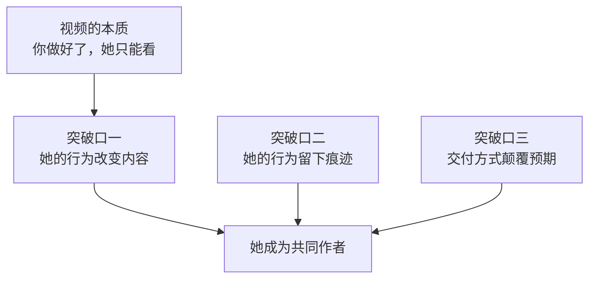
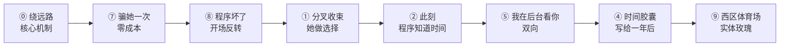
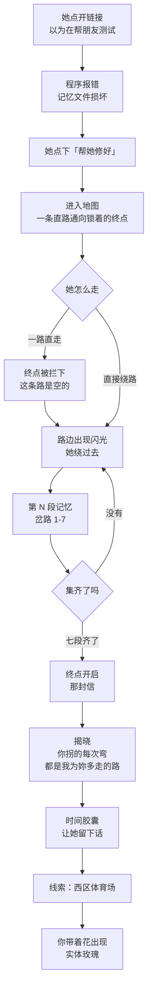
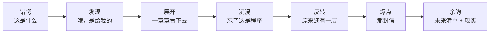
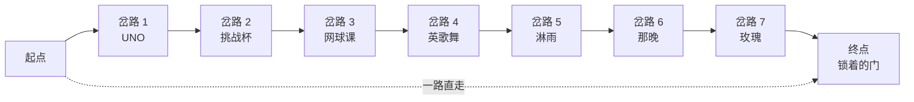
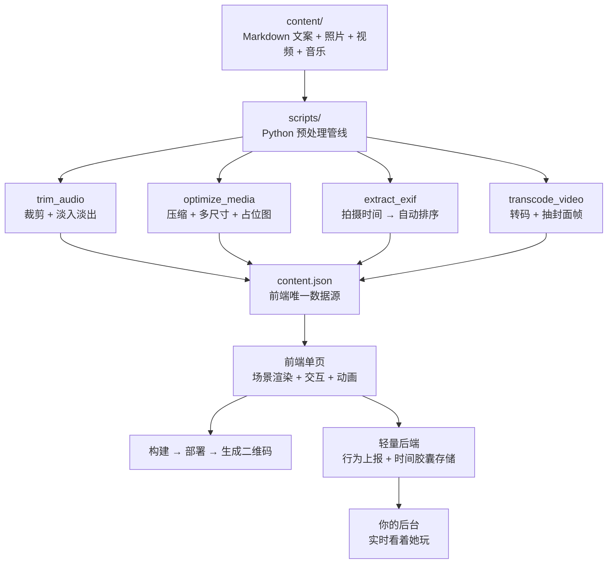
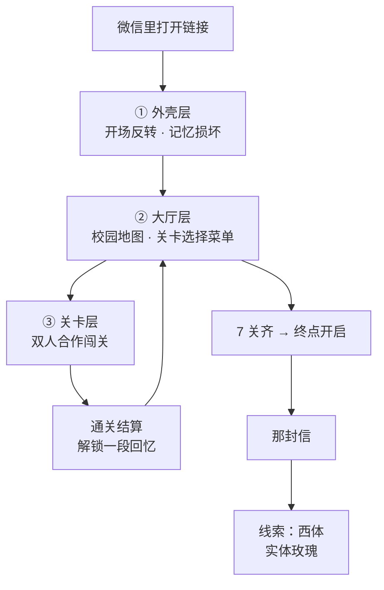

# 项目代号「回声」· 构思文档

> 代号含义：她留下什么，它就回应什么；一年之后，它还会回来找她。

| 项 | 内容 |
|---|---|
| 项目类型 | 生日惊喜 · 互动式网页体验 |
| 目标用户 | 唯一一个人 |
| 开发周期 | 约 3 周 |
| 交付方式 | 发链接，她独自在手机上打开 |
| 技术栈 | Python 内容管线 + 前端单页 + 极轻后端 |
| 文档状态 | **构思定稿 v2** · 逻辑已闭环 |

---

## 一、一句话定位

> **这不是一个网页，是给她一个人做的游戏；而且她不是观众，是共同作者。**

**核心主题**：

> **我一直在绕远路。而每一条远路的尽头，都是你。**

这条主题不是修辞，它是**游戏机制本身**（见 ⓪ 绕远路）。

---

## 二、为什么不能做成视频

先说清楚要避开的坑。

「视频」和「幻灯片式网页」的本质是一样的：**你做好了，她只能看**。她点一下、看一段，再点一下、再看一段——**被动消费就是被动消费，包装成什么样都掩盖不了。**

一般的解法是在**呈现形式**上做加法（更多动画、更炫的转场）。但形式再怎么变，她还是在"看"。这条路走到头也只是"一个做得比较漂亮的视频"。

真正的突破口只有三个，全都在**机制**层面：



**核心理念**：

> 视频是「我讲给你听」。
> 我们要做的是「**你得动手，而且我参与其中**」。

---

## 三、设计红线

以下几条是硬约束，任何设计冲突时以此为准。

### 3.1 关卡是「仪式」，不是「挑战」

> **绝不允许她被卡住。**

- 惊喜感全在**「点下去会出现什么」**，不在**「我解开了」**
- 任何需要思考超过 20 秒的环节，都是在消耗耐心，而不是增加感动
- 解法要么一眼可见，要么提示直接写在脸上
- **唯一的难度应该来自情感，不是操作**
- 允许她乱点，乱点也必须有反馈

### 3.2 独自打开 = 程序必须自己撑住节奏

她不在你身边，没人留得住她。所以：

- 必须有**明确的目标感**（「还差两个信物」比「下面还有内容」牵引力强十倍）
- 必须有**进度可见**
- 开场 15 秒内必须建立**「我要往下走」的动机**

### 3.3 内容与代码彻底分离

你后面 80% 的时间会花在改文案、换照片上。

> **绝不能改一个字就动一次代码。**

所有文案、图片、音频、时间线，全部走 `content.json`，前端只读数据。

### 3.4 全程保密

- 共同设备上不留痕迹
- **文件名不要出现「雅馨」「生日」「礼物」等字样**
- 本文档即已采用中性命名

---

## 四、核心机制清单

以下机制是本方案的「创意库存」。每个都标注了实现成本，最终按组合方案选取。

---

### 机制 ⓪ 「绕远路」 ⭐ 核心机制

> **这是整个作品的骨架。游戏机制即故事内核。**

把七件真实事件按时间排开，它们有同一个形状：

| 事件 | 当年的做法 |
|---|---|
| 网球课 | 为了陪她上 **1-2 节**，把自己课表也改成 1-2 节。选课已截止，所以**再一个人上一遍 4-5 节**（因为要签到） |
| 英歌舞 | 每次开课前，**骑车绕过去接她** |
| 玫瑰花 | **骑电动车**跑去买，放到西区体育场 |
| 淋雨那天 | 一起被淋成狗，**她在背后替他挡雨** |

**共同点：他一直走的是更远的那条路。**

**游戏就是让这一切重演：**

- 地图上有一条**直路**，快速通向终点，但沿途什么都不发生
- 直路旁依次分布 **7 个岔路口**，每个岔路口是一段记忆
- 终点是锁着的：**「还差 7 段记忆」**
- 她想通关，**必须一路拐 7 次弯**

**最后揭晓**：

> **「你刚刚拐的每一次弯，都是我当年为你多走的每一段路。」**

她不是在看他的付出——**她在重演他的付出**。

**为什么这是解**：

1. **机制即内容**——玩法本身承载主题，不是包装
2. 「分叉收束」的极致形态：无论她怎么绕，都会绕回同一条路
3. 最后的揭晓**有物理重量**：不是「我送了你 7 件礼物」，而是「你走的每一步我都走过」
4. 与「记忆文件损坏」的设定天然咬合：她在**按顺序恢复记忆**

---

### 突破口一：她的行为改变内容

#### 机制 ① 「分叉收束」

给她做选择，每个选择通向不同分支、不同照片、不同的话。但——

> **无论她怎么选，最后所有路径都收束到同一句话。**

示例收束句：「你看，不管你选哪条路，我都在这里。」

- **为什么妙**：她以为自己在玩分支，其实你早就知道终点。这种"被预谋感"本身就是最大的浪漫。
- **成本**：中（文案量约 2–3 倍，但结构可以做得很轻）
- **结构**：3–4 个岔路点，各分出两三条支线，最终合流

#### 机制 ② 「此刻」

程序**真的知道**现在是几点、今天什么天气、她用什么设备。

| 打开时机 | 程序反应 |
|---|---|
| 23:47 | 「这个点你还没睡啊」 |
| 凌晨 | 「你又熬夜了」+ 专属内容段 |
| 第二天早上 | 「昨晚没点开，我等你到今天」 |

**同一个链接，在不同时刻打开是完全不同的东西。**

- **为什么妙**：让她意识到「这东西是活的，是在等我的」。
- **成本**：极低（几行条件判断）
- **性价比**：全场最高

#### 机制 ③ 「你想看哪个版本的我？」

开场就让她二选一：

> 「你想知道，我眼里的你是什么样？还是你眼里的我是什么样？」

选完之后整个内容走向完全不同。

- **为什么妙**：把「她想看什么」的决定权交出去，她立刻从观众变成参与者。
- **成本**：中

---

### 突破口二：她的行为留下痕迹

#### 机制 ④ 「时间胶囊」

最后一关不是给她看东西——

> **是让她录一段话 / 写一段字，「给一年后的我们」。**

程序存下来，生成只属于她的标识。然后在**她的下一个生日**，这个程序自己再发一次给她，把那句话还给她。

- **为什么妙**：这是唯一一个能让你**在一年后再赢一次**的方案。它让惊喜拥有长尾。
- **成本**：中（需要轻量后端存储）
- **风险**：域名别过期

#### 机制 ⑤ 「我在后台看着你玩」 ⭐ 灵魂机制

她以为这是一个人的游戏。但她在里面写的每个字、每次犹豫了几秒、在某一关反复点了几次——**都实时传给你，你在后台看着她玩。**

可以做的事：

- 掐着她在某一关停住的时候，突然给她发一条消息
- 她通关的瞬间，你打电话过去
- 事后告诉她：「你在第三章停了 40 秒，我就知道你在哭」

> **这才是程序的真正用法，不是替代你，是让你在场。**

- **为什么妙**：把单向的「送礼物」变成双向的「两个人一起完成」。这是**「惊喜」与「表演」的分界线**。
- **成本**：中（轻量后端收几十条数据而已）

#### 机制 ⑥ 「未来清单」

结尾让她勾选/填写你们要做的事。填完生成一张可保存的图，或一个独一无二的链接。

一年后你们一起回来打勾。

- **成本**：低

---

### 突破口三：交付方式颠覆预期

> **这一条性价比最高，因为它几乎不花技术成本。**

#### 机制 ⑦ 「骗她一次」

不告诉她这是生日礼物。用别的事由让她点开：

> 「我最近写了个小东西，你帮我测一下能不能跑通？」
> 「我做了个小游戏，你能通关吗？」
> 「帮我看看这个网页排版乱没乱？」

她带着**完全不同的预期**点开，然后发现真相。

- **为什么妙**：预期落差是惊喜的倍增器。她毫无防备的时候，杀伤力是做好准备的三倍以上。
- **成本**：零
- **注意**：这一条与其它方案**完全兼容，是叠加的，不是二选一**

#### 机制 ⑧ 「程序坏了」

开场让程序**故意报错、花屏、显示乱码**。她盯着看，发现"错误信息"不对劲：

```
[ERROR 0x0520] 2023-05-20 的记忆文件已损坏
[WARNING]      检测到 3 段未发送的消息
[SYSTEM]       正在尝试恢复…

               要帮她修好吗？   [ 是 ]
```

点「是」→ 进入正片。

- **为什么妙**：**把 bug 做成机制**。她以为自己真的在"修复"什么，实际上是在一步步恢复你们的记忆。**她不是在看故事，她在救故事。**
- **成本**：低（纯前端）
- **风险**：**别做得太像真崩了**，否则她会直接关掉。必须在 5 秒内给出"不对劲"的钩子

#### 机制 ⑨ 「下半场在现实里」

程序最后一关不给结局，给**线索**：

> 「真正的最后一件东西，不在屏幕里。」
> 「去你第一次把围巾忘在椅子上的那个位置。」

她在那个地方找到一封**实体信**。

- **为什么妙**：屏幕延伸到物理世界的那一刻，体验层级完全不同。程序成了引路人，而不是终点。
- **成本**：低（技术成本几乎为零，但要提前布置）
- **前置条件**：**需要你们在同一个城市**

---

## 五、推荐组合方案

如果只选一套，采用如下链路：



| 机制 | 承担的角色 | 优先级 |
|---|---|---|
| **⓪ 绕远路** | **骨架 · 机制即内容** | **必选** |
| ⑦ 骗她一次 | 开场 · 预期落差 | 必选 |
| ⑧ 程序坏了 | 开场 · 第一钩子 | 必选 |
| ① 分叉收束 | 中段 · 参与感 | 必选（落在关卡 3） |
| ② 此刻 | 贯穿 · 活的细节 | 必选（成本极低） |
| ⑤ 我在后台看你 | **灵魂 · 双向在场** | 必选 |
| ④ 时间胶囊 | 结尾 · 长尾 | 推荐 |
| ⑨ 西区体育场 | 收尾 · 层级跃迁 | 必选（同城已确认） |

> **⓪ 是骨架，⑤ + ⑨ 是灵魂。**
> ⓪ 让玩法承载主题，⑤ 让单向变成双向，⑨ 让屏幕延伸到现实。
> 三者合起来，这个程序才从「一个作品」变成「一次事件」。

---

## 六、体验流程蓝图



### 情绪节奏曲线

惊喜最忌「一上来就到顶」，必须这样铺：



| 阶段 | 设计要点 |
|---|---|
| 错愕 | **必须撑住 3–5 秒**。人对「意外」的注意力是「预期之内」的好几倍 |
| 发现 | 第一次点破，但**不要一次说完** |
| 展开 | 她开始有动机主动点击 |
| 沉浸 | 靠音乐与滚动节奏。照片出现尽量**卡在音乐情绪点上** |
| 反转 | 看完正片以为结束了，出现一个只有她能操作的入口——**这才是"程序"存在的意义** |
| 爆点 | 那封信 |
| 余韵 | 沉淀，不急着结束 |

---

## 七、关卡设计

### 7.1 路线设计



- **直路**：从起点直通终点，很快，但**沿途什么都不发生**
- **七个岔路**：沿直路依次分布，越往后越远
- **终点是锁着的**：「还差 7 段记忆」

**她想通关，必须一路拐 7 次弯。**

### 7.2 状态机（必须穷举，否则会卡死）

| 她的行为 | 系统反应 | 目的 |
|---|---|---|
| 沿直路一直走 | 到终点被拦下：「这条路是空的。你好像漏了什么。」 | 建立「必须绕路」的认知 |
| 反复走直路 | 第 2 次提示加强，**路边第一个闪光变得明显** | 防止烦躁 |
| 拐进岔路 | 触发该段记忆 | 正反馈 |
| 卡住超过 30 秒 | 出现**呼吸感的箭头**指向最近未解锁的岔路 | 兜底 1 |
| 卡住超过 60 秒 | 直接把她「吸」到岔路口 | 兜底 2 |
| 乱点空白处 | 轻微涟漪反馈，**不报错、不惩罚** | 红线：允许乱点 |
| 重复点已解锁的岔路 | 可以**重看**，进度不变 | 不惩罚好奇心 |
| 中途退出 | 进度存 localStorage + 上报 | 下次接着走，**且你知道她退了** |
| 第二次打开 | 从上次位置继续，加一句「你回来了」 | 机制 ② 此刻 |

> **三重兜底是红线。她永远不该有「我卡住了」的体验。**

### 7.3 七关详表

| # | 岔路 | 主视觉 | 交互 | 内容 | 上报数据 |
|---|---|---|---|---|---|
| 1 | UNO | 一副散开的牌 | 点击 | 起点。「一切从一副 UNO 开始」 | 停留时长 |
| 2 | 挑战杯 | 一张饭桌 | 点击 | 带她拿奖 → 她请吃饭 → 聊到快门禁才回 | 停留时长 |
| 3 | **网球课** | 两个课表 | **二选一** | ⭐ 全片最强 | **先点哪个 / 犹豫多久** |
| 4 | 英歌舞 | 电动车与夜路 | **滑动前进** | 路很长。结尾：「这条路我骑过很多次」 | **滑了多久** |
| 5 | **淋雨** | 雨幕 | **长按挡雨** | ⭐ 反转 | **长按了多少秒** |
| 6 | 那晚 | 一盏路灯 | 点击 | **留白**（见 7.5-C） | 停留时长 |
| 7 | 玫瑰 | 拼图 | **拼图** | 收束，通向终点 | 拼图耗时 |

### 7.4 两枚核弹

#### 关卡 3（网球课）：全场最强的一关

屏幕上出现两个课表格子：

```
    ┌──────────────┐   ┌──────────────┐
    │  1-2 节      │   │  4-5 节      │
    │  你在哪里？  │   │  我在哪里？  │
    └──────────────┘   └──────────────┘
```

- 她点 **1-2 节** → 「这里，我们在一起。」
- 她点 **4-5 节** → 「这里，只有我一个人。」
- 两个都点完（无论顺序）→ 揭晓：

> **「我每周都上两遍课。一遍陪你，一遍为了签到。」**
> **「你只见过我们在一起的那一遍。」**

然后是那个数字——**16 周**：

> **「16 周。你上了 16 次课。」**
> **「我上了 32 次。」**

数字从 16 翻倍到 32 的动画。

**这是「分叉收束」的完美落地**——不管她怎么点，最后都通向同一句真相。而且这真相**她从来没听过。**

#### 关卡 5（淋雨）：反转设计

- 屏幕在下雨
- 提示：「**按住屏幕，给她挡雨**」
- 她长按 → 雨慢慢变小
- 雨停后弹出：

> 「你做到了。」
> 「……但那天，**是你在我背后替我挡的**。」

**她以为自己在保护你，结果发现被保护的人是你。** 力道来自——她刚刚**亲手做了一遍你当年想做的事**，然后被告知「其实你早就做过了」。

### 7.5 三种「说不清」的处理（重要）

素材里有三处是说不清或不想写的。**它们不是缺陷，全部转化成了设计。**

#### A. 英歌舞接了几次 —— 记不清，那就不要数字

> ❌ 「我一共接了你 37 次」（编错就尴尬）
> ✅ 「**每一次**开课前，我都在楼下等你」

「每一次」比任何数字都有力量，**因为它没有上限**。

关卡 4 结尾：

> 「这条路我骑过很多次。」
> 「多到我已经不记得是几次了。」

**「不记得次数」，就是次数很多的证明。**

#### B. 为什么想打网球 —— 记不清，让「不记得」成为内容

> 「你想学网球的理由，我已经不记得了。」
> 「但我记得，你说完那句话的下一秒，我就答应了。」

重点从**原因**移到**反应**。记不住原因，却记住了自己的反应——**这恰恰证明了当时的分量**。

#### C. 那晚 —— 你不想写，那就留白

你说「那晚不用把细节写出来，我们俩之间都懂」。

**这不是缺失，这是设计。**

关卡 6 什么都不写：

- 黑屏，只有一盏路灯（或一只空杯）
- 只有一句话：

> 「这一晚，只有我们两个人知道。」

**留白的力量在于：她会自己把内容填进去，而且填得比任何文案都满。**

而且这样处理，这一关反而成了**私密感最强的一关**——它不向任何人解释，包括这个程序。

### 7.6 形态

| 形态 | 游戏感 | 实现成本 | 评价 |
|---|---|---|---|
| **地图探索 + 岔路**（点热点触发） | 中 | 低 | ⭐ 定稿形态 |
| 像素风闯关 | 强 | 高 | 3 周太紧 |
| 视觉小说 | 弱 | 极低 | 作为关卡的表达形式使用 |

**定稿：地图探索当骨架，视觉小说当血肉。**

实现上就是**背景图 + 热点区域**，成本极低，把省下的时间全砸在内容打磨上。

### 7.7 结尾：西区体育场 ⭐

> **待确认**：西区体育场是否就是表白现场？

如果是——**这是全场唯一一个「地点」**，而且它同时承载起点和终点：

| | 当年 | 现在 |
|---|---|---|
| 花 | 他骑电动车去买，放在西区体育场，让伟浩偷偷送过来 | 你带她去西区体育场，**花在那里等她** |
| 姿态 | **在暗处**：趁她忙，偷偷准备 | **在明处**：她看着你做这件事 |

**闭环**：当年是「我去找花」，现在是「花在那里，我们一起走过去」。

而且——**「骑电动车去买花」本身就是绕远路**，完美咬合核心机制。

**流程**：

1. 她通关 → 程序说「最后一件东西不在屏幕里了」
2. 显示线索：**西区体育场**
3. **程序同时给你发通知**（后端上报，机制 ⑤）
4. 你带她去西区体育场，或者你已经在那里等
5. 花在那里

> ⚠️ **前提**：她看完时你们能同时出现在那儿。如果时间不好控制，退化方案：**她在程序里看到「西区体育场」四个字，然后抬头，你站在门口，手里拿着花。**

---

## 八、视觉与音乐

### 8.1 音乐是强项，也最容易翻车

浏览器**禁止自动播放音频**，必须用户交互后才能播放。很多人把它当障碍，其实应该当设计：

- 「点击开启我们的歌」→ **把技术限制变成入场仪式**
- 音乐跟着章节切换，切换点做淡入淡出
- 照片 / 视频的出现时机尽量**卡在音乐的情绪点上**

### 8.2 首屏加载体验

照片量大时体验崩塌是常见死法：

- 生成 BlurHash / LQIP 占位图
- 预加载下一屏，当前屏再解码
- 视频必须先出封面帧，再按需加载

---

## 九、技术架构

### 9.1 总体结构



### 9.2 Python 内容管线

| 脚本 | 为什么必须有 |
|---|---|
| `optimize_media.py` | 手机原图每张 3–8MB，几十张就是几百 MB。必须压到 web 尺寸 + 生成渐进式占位图，否则首屏白屏 10 秒 |
| `transcode_video.py` | 手机拍的 4K 直接放网页必卡死。要转 720p/1080p，还要抽封面帧 |
| `trim_audio.py` | 完整歌曲太长，要裁到章节长度 + 淡入淡出 |
| `extract_exif.py` | 自动读拍摄时间 → 自动排序章节，省去手工整理 |
| `build_content.py` | Markdown → JSON，带 frontmatter 校验 |
| `check_assets.py` | **检查哪一关缺素材、文案没写。** 做到一半忘记素材是常态 |

### 9.3 前端

- 单页应用，结构尽量轻（重型构建工具的收益在这个项目里很低）
- 章节渲染 + 热点点击 + 滚动动画
- 动画建议用 GSAP 系的滚动驱动方案

### 9.4 轻量后端（机制 ⑤ / ④ 依赖）

只需要：

- 一个接收上报的接口（谁、哪一关、停留多久、点了几次）
- 一个时间胶囊的存取接口
- 一个你能随时查看的简易后台

数据量极小，不需要复杂架构。

---

## 九·五、v3 架构定稿：双人联机闯关

> 这一节是**最终定稿**。前面第九节的内容作为素材管线依然有效，
> 但「互动形式」已被替换为下面这套。

### 9.5.1 三层结构



| 层 | 职责 |
|---|---|
| ① 外壳层 | 开场反转、层间转场、结尾、通知你 |
| ② 大厅层 | 校园地图 + 关卡选择 + 进度存档（她说的"过一关有个菜单"） |
| ③ 关卡层 | 实际玩的平台跳跃，每关 1-2 分钟 |

**「绕远路」主题原封不动保留**：大厅地图上是一条直路 + 7 个岔口，
她想通关必须绕 7 次。最后揭晓：**她绕的每一次，都是他当年多走的每一段。**

### 9.5.2 网络模型：各管各的本地模拟 ⭐

**这是整个技术方案里最重要的一个决定。**

| 角色 | 谁模拟 | 延迟 |
|---|---|---|
| **自己的角色** | 本地模拟 | **0** |
| **对方的角色** | 网络快照 + 110ms 插值 | 无感 |
| **服务器** | **只做中继，不做任何游戏逻辑** | — |

**由此得出三个结论：**

1. **手感永远不受网络影响** —— 平台跳跃最重要的就是跟手
2. **网络延迟只影响「对方角色的显示」** —— 所以高延迟的穿透工具完全可用
3. **服务器代码永远很小**（约 200 行），不可能成为瓶颈

**参数**：20Hz 同步、单包约 40 字节、带宽约 **1 KB/s**。

**冲突仲裁**：绝大多数状态各管各的，只有跨角色交互（接力开关、通关判定）
交给 **Host**（先进房间的人）说了算。

### 9.5.3 双角色与叠罗汉

| 角色 | 是谁 | 谁来操控 |
|---|---|---|
| **小兔** | **她自己** | 她 |
| **小熊** | **你** | 你（联机） |

> **她操控的角色是她自己。另一个角色，是真的你。**

**合作机制**：叠罗汉（踩肩）、接力开关、救援、**强制分开行动**。

**物理数值的因果关系**（改数值前必须验算）：

- 单人可跳高度 ≈ **163px**
- 叠罗汉后可达高度 ≈ **245px**
- → 关卡里 **170~240px 高的平台，单人绝对上不去，必须合作**

这不是美术参数，是**关卡设计的约束条件**。

### 9.5.4 联机让关卡 3 从"很强"变成"封神"

回想当年真实发生了什么：

> **你在 4-5 节的教室，她在 1-2 节的球场。**
> **你们不在同一个画面里。**

单机方案只能让她"扮演"这件事。**联机让她真的经历这件事：**

- 游戏强行把两个角色分到两个区域
- **屏幕上看不到对方**（这是设计，不是 bug）
- 她在那头等，你在这头走
- 各自到终点才会合

> **「你只见过我们在一起的那一遍」——这个真相，在游戏里变成了她的亲身体验。**

### 9.5.5 七关定稿

| 关 | 地点 | 双人机制 | 回忆 |
|---|---|---|---|
| 1 | 操场 · UNO | 教学：学会叠罗汉 | 「一切从一副 UNO 开始」 |
| 2 | 挑战杯 | 接力开门，两人同时到达 | 拿奖 → 请吃饭 → **聊到快门禁** |
| **3** | **网球课** | ⭐ **强制分屏，看不到对方** | ⭐ 16 周 / 32 遍课 |
| 4 | 英歌舞 | 骑电动车，一人骑一人坐 | 「这条路我骑过很多次」 |
| **5** | **淋雨** | ⭐ 长按挡雨 → 反转 | 「那天是你在我背后替我挡的」 |
| 6 | 那晚（麻将后喝酒） | 只是走到路灯下 | **留白** |
| 7 | 西体 · 玫瑰 | 两人一起把花送到 | 收束，通向结尾 |

> **淋雨和那晚是两件不同的事，不合并。** 中间隔关卡 6 的留白，
> 情绪是「淋雨（浓）→ 那晚（空）」的对比，比连在一起更强。

### 9.5.6 降级：联机失败也要能玩

**这是保命设计。**

- 连接超时 4 秒 → 自动进入 **offline 模式**，游戏仍可完整游玩
- 对方掉线 → 角色半透明显示，可继续
- 静态资源**可以独立部署**（CDN / 任意静态托管），穿透只扛 WebSocket
  → 即使穿透挂了，她至少能打开页面进单机模式

> **绝不允许出现「她点开一片白屏」或「卡在连接中」。**

---

## 十、部署与交付

### 10.1 微信内置浏览器的三个坑 ⚠️

**她一定是在微信里点开链接**，这是个有特殊限制的环境：

1. **音频**：微信内置浏览器限制更多，自动播放更不可能。但用户点击后的播放通常没问题——正好配合「点击开启我们的歌」的设计
2. **视频**：`playsinline` 属性**必须加**，否则 iOS 上会强制全屏播放，页面直接崩
3. **域名与速度**：必须 HTTPS，且**加载速度要实测**。国内访问境外托管经常很慢甚至打不开——**这是"她点开一片空白"的直接原因**

> **部署这一步别偷懒。惊喜翻车最多的环节就是这里。**

需要在动手前**实测**确认最终托管方案，保证微信内秒开。

### 10.2 交付的仪式感

**程序做完了，怎么送出去和程序本身一样重要：**

- 用机制 ⑦ 的方式发出，别直接甩链接
- 可以**印一张实体卡片**，上面一个二维码，配一句手写的话
- 可以买个相关域名，仪式感直接翻倍
- **全程别让她发现你在写这个**

---

## 十一、排期（约 3 周）

| 时间 | 任务 |
|---|---|
| D1–2 | 搭骨架 + 地图/岔路系统，跑通「一个空白岔路 → 手机上能打开」的完整链路 |
| D3–4 | Python 媒体管线；**同时把所有素材先放占位文件**，不因为缺素材停工 |
| D5–7 | 开场反转（机制 ⑧）+ 地图与直路/岔路逻辑 + 状态机 |
| D8–14 | **一天一关**，填内容与文案。重点砸关卡 3 和 5 |
| D15–16 | 音乐卡点、动画打磨、**真机实测（至少 3 台不同手机）** |
| D17 | 写那封信（**留到最后写**，前面的东西会喂给你灵感） |
| D18 | 轻后端（机制 ⑤ 上报 + ④ 时间胶囊）+ 你的后台看板 |
| D19 | 部署 + 微信内实测 + 写开场话术（机制 ⑦）+ 安排西区体育场 |
| D20–21 | 留缓冲。一定会出事 |

**并行推进（全程穿插，不占开发时间）：**

- [ ] 补拍素材：电动车、网球场、西区体育场
- [ ] 翻当年的课表截图
- [ ] 联系伟浩（确认能不能用他的名字）
- [ ] 选背景音乐

> 原则：**D1 搭框架，剩下全部用来填内容。素材永远可以后补。**

---

## 十二、信息状态

### 12.1 已确认

| 项 | 内容 |
|---|---|
| 周期 | 约 3 周 |
| 交付 | 发链接，她独自在手机上打开 |
| 位置 | **同城，可以见面** → 机制 ⑨ 可用 |
| 设备 | 不确定 → **按 iOS 微信最严标准实现**（两端都能跑） |
| 起点 | 朋友一起在操场玩 UNO 认识 |
| 事件 1 | 带她打挑战杯**拿奖** → 她请吃饭答谢 → **聊到快门禁才回** |
| 事件 2 | 网球课：她说想学，他把自己课表改成 1-2 节；选课已截止，所以每周陪上 1-2 节，再一个人上 4-5 节（要签到）。**共 16 周 = 32 遍课** |
| 事件 3 | 英歌舞励能计划：每次开课前骑电动车去接她，路上聊天。**次数已不记得** |
| 事件 4 | 惠任康养比赛，校三等奖。结束后一起吃饭拿快递，下超大雨，两人被淋成狗，**她在背后替他挡雨** |
| 事件 5 | 她突然叫他打麻将 → 打完去喝酒到很晚 → 第二天英歌舞新人见面会 |
| 事件 6 | 表白：她说想「正式一点」，他趁她在 v 社忙时**骑电动车**去买了一大朵玫瑰，放在**西区体育场**，让伟浩偷偷送过来 |
| 素材 | 当时的照片/截图基本没有 → **先用占位，后续补拍或生成** |

### 12.2 待你确认

- [ ] **西区体育场**：是否就是表白现场？如是，这就是全场最重要的地点（见 7.7）
- [ ] **伟浩**：帮忙送花的同学吗？这段要不要出现在程序里（可以只提一句，或做成彩蛋）
- [ ] **生日具体日期**
- [ ] 背景音乐/歌：说了没有特定的，定稿时再选

### 12.3 说不清的部分（已转化为设计）

| 想不起来 / 不想写的 | 处理方式 | 位置 |
|---|---|---|
| 英歌舞接了几次 | 不写数字，写「**每一次**」 | 7.5-A |
| 为什么想学网球 | 让「**不记得**」本身成为内容 | 7.5-B |
| 那晚聊了什么 | **留白设计**，一句「只有我们两个人知道」 | 7.5-C |

> **这三条不是妥协，是升级。** 它们让文案从「陈述事实」变成「传递感受」。

---

## 十三、素材清单与占位规范

### 13.1 现状

当时拍摄的照片/截图**基本没有**。

> **对策：先用占位符开发，绝不因为等素材而停工。**

### 13.2 优先级与补齐方式

| 素材 | 用途 | 优先级 | 补齐方式 |
|---|---|---|---|
| **网球课课表 / 选课记录截图** | 关卡 3 直接封神 | ⭐⭐⭐ | 先翻当年的截图；找不到就重绘/生成 |
| **西区体育场** | 关卡 7 / 结尾 | ⭐⭐⭐ | **现在就去拍**，白天和黄昏各一张 |
| **你们俩的合照** | 拼图 / 结尾 | ⭐⭐⭐ | 手里应该有 |
| 电动车 | 关卡 4 主视觉 | ⭐⭐ | **顺手拍一张真的**（同城，找借口就行） |
| 网球场 | 关卡 3 背景 | ⭐⭐ | 补拍 |
| 玫瑰花 | 关卡 7 | ⭐⭐ | 补拍 / 生成 |
| UNO 牌 | 关卡 1 | ⭐ | 补拍 / 生成 |
| 麻将桌 | 关卡 6 | ⭐ | 补拍 / 生成 |

> **关于「生成素材」**：拿不到当时照片时可用，但注意两点——
> 1. 风格必须**统一**（要么全插画，要么全实拍，别混着）
> 2. **人物照片绝对不要生成**，一律用真实合照

### 13.3 占位规范

开发阶段**不要等素材**，约定如下：

- 所有素材路径写死在 `content.json` 里
- 缺失的素材放一个**同名占位文件**（纯色块 + 文字标注「待补：网球场照片」）
- 前端**不关心素材真假**，直接跑通全流程
- 跑 `check_assets.py` 就能列出所有还缺的素材

**这样你今天就能开工，素材后面慢慢补。**

---

## 十四、风险清单

| 风险 | 影响 | 对策 |
|---|---|---|
| 开场"报错"做得太真 | 她直接关掉 | 5 秒内必须给出"不对劲"的钩子 |
| 微信内打不开 / 加载慢 | **致命**，惊喜直接归零 | 提前实测，多准备一个备用域名 |
| 视频未加 `playsinline` | iOS 强制全屏，页面崩 | 构建时校验 |
| 素材体积过大 | 首屏白屏 10 秒 | Python 管线强制压缩 |
| 关卡过难 | 她卡住 → 烦躁 → 惊喜感消失 | 红线：20 秒内可解 |
| **关键数字记错** | ⚠️ **反噬**。16 周/32 遍课**她是当事人，她记得** | **上线前必须核准每一个数字**，不确定的宁可不写 |
| 留白那关被当成程序出错 | 她以为卡了，直接关掉 | 留白要有明确的视觉语言（黑屏+路灯+呼吸感的文字） |
| 西区体育场时间对不上 | 结尾无法闭环 | 提前排好行程；备好退化方案（她抬头，你已在门口） |
| 补拍素材时被她发现 | 惊喜归零 | 用「路过」「顺手拍」的理由；别在共同相册留痕 |
| 时间胶囊域名过期 | 一年后无法回访 | 一次性买多年 / 用长期稳定方案 |
| 提前被她发现 | 惊喜归零 | 中性文件名，共同设备不留痕 |
| 排期无缓冲 | 临期手忙脚乱 | D20–21 强制留白 |

---

## 十五、一句话总结

> **视频是「我讲给你听」。**
> **而这里的一切，都是为了让她动手，并且让你在场。**

而整个故事只有一个形状：

> **我一直在绕远路。**
> **而每一条远路的尽头，都是你。**
