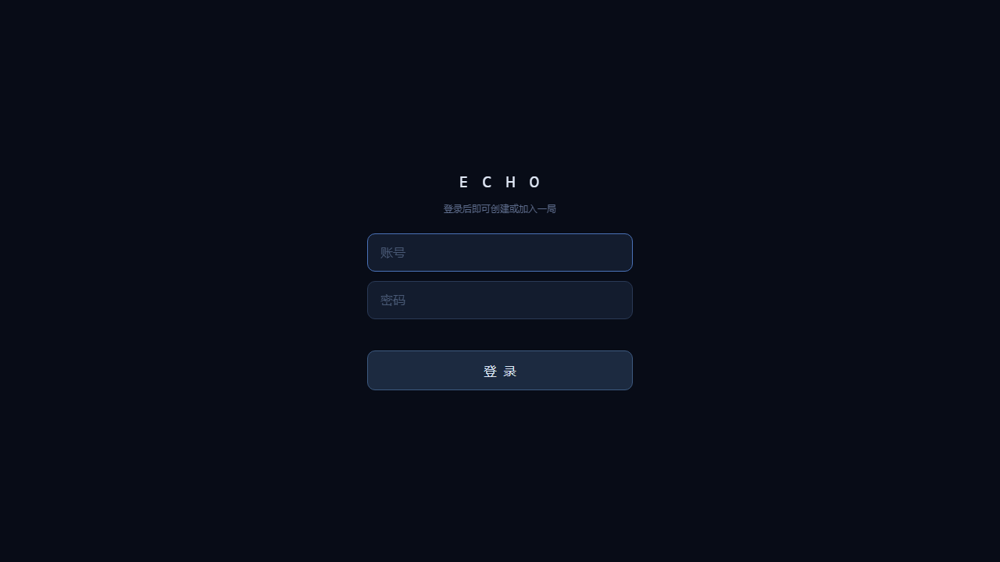
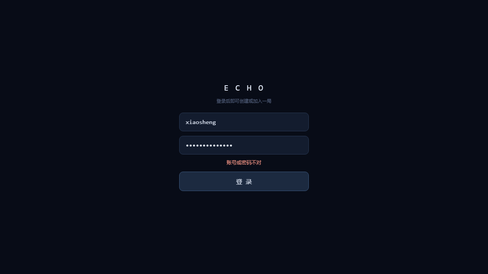
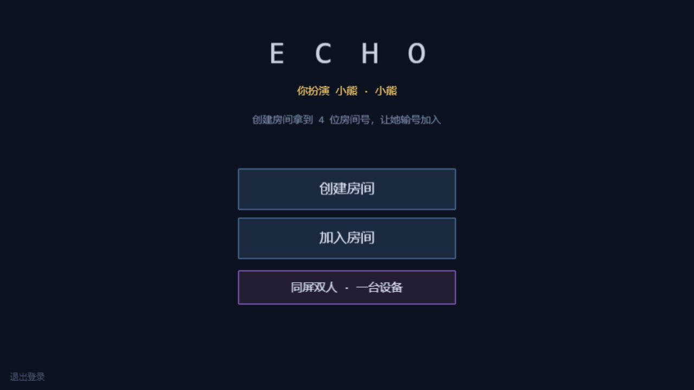
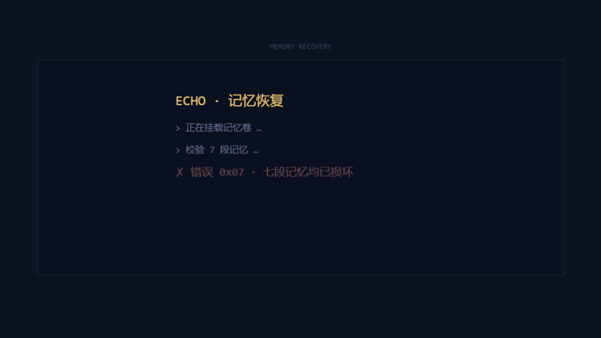

# 01 · 登录与开场

## 1.1 账号登录

### 功能描述

进入首页先见登录层（DOM 表单浮在游戏画面上）。账号密码由服务端校验（`POST /api/login`），通过后签发 token、建立 WebSocket 连接，进入游戏大厅。两个角色各绑定一个账号：`xiaosheng` 是小熊、`baobao` 是小兔。

### 使用教程

1. 打开首页，在「账号」输入用户名、「密码」输入密码；
2. 点「登 录」；
3. 密码错误时表单下方红字提示，不进入游戏；正确时直接进入大厅。

### 测试数据

| 用例 | 输入 | 期望 |
|---|---|---|
| 错误密码 | `xiaosheng` / `wrong-password` | 被拒绝，显示错误，不进大厅 |
| 正确密码 | `xiaosheng` / `20050114` | 进入大厅（Menu 场景） |

### 输出

- 错误密码：`#login-error` 显示 **「账号或密码不对」**，停留登录页；
- 正确密码：活动场景切换为 `Menu`，右上角出现身份标识（小熊）。

| 用例 | 结果 | 实际输出 |
|---|---|---|
| 错误密码被拒绝 | PASS | errorText = 「账号或密码不对」 |
| 正确密码进入大厅 | PASS | activeScene = Menu |

### 截图

## 1.2 开场反转演出（首次进入）

### 功能描述

**首次**登录（本地无 `introSeen` 标记）时，登录后先播一段「存档已损坏 / 记忆被重写」的终端风反转演出，把"这是两个人的记忆"这个前提先摔碎再重建。按空格/点击可快进；看完之后本地记录标记，之后再进不再播放。

### 使用教程

无需操作，首次登录自动播放；按 **空格** 或点击屏幕快进。

### 测试数据

| 用例 | 输入 | 期望 |
|---|---|---|
| 首次登录（无标记） | 账号密码登录 | 先进入 Intro 场景播放演出 |
| 空格快进 | 连按 10 次空格 | 演出跳完，进入 Menu |

### 输出

- 首屏场景 = `Intro`（演出中）；快进后 = `Menu`。已看过标记的老用户登录后直接到 `Menu`（本报告其余 41 个用例即在此前提下跑通，反向印证了跳过逻辑）。

| 用例 | 结果 | 实际输出 |
|---|---|---|
| 首次登录播放「记忆损坏」演出 | PASS | 首屏 Intro → 快进后 Menu |

### 截图

