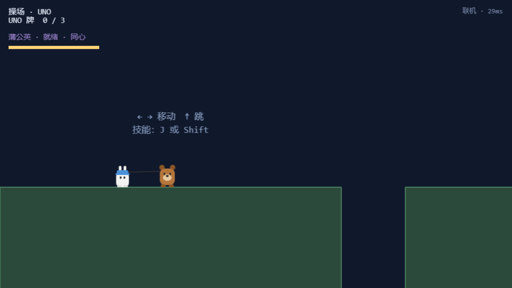

# 02 · 房间与联机

## 2.1 创建房间

### 功能描述

在大厅点「创建房间」，服务端生成 **4 位房间码**（字母表去掉了易混的 0/O/1/I），页面弹出房间码面板，可一键**复制邀请链接**（`?r=房间码`）发给她。

### 使用教程

1. 登录后在大厅点 **创建房间**；
2. 弹出房间码面板，把「复制邀请链接」得到的链接发给她；
3. 房间码面板保持打开，等待她加入。

### 测试数据

| 用例 | 输入 | 期望 |
|---|---|---|
| 创建房间 | 大厅点击「创建房间」 | 弹出面板，房间码为 4 位大写字母数字 |

### 输出

- `#roomcode` 面板显示，`roomCode = "KZ6E"`（每次随机，多轮测试分别得到 RKN5 / K5NL / BB5T / 9255 等，均符合 4 位格式）；
- WebSocket 收到 `{"t":"created","code":"...","isOwner":true,"role":"bear"}`。

| 用例 | 结果 | 实际输出 |
|---|---|---|
| 创建房间得到 4 位码 | PASS | roomCode = KZ6E（格式校验 `/^[A-Z0-9]{4}$/` 通过） |

### 截图

## 2.2 通过分享链接加入房间

### 功能描述

她点开 `.../?r=房间码` 这样的链接后，游戏在登录成功时会**自动加入**该房间（`net.autoStart()`）——不需要手输房间码。这正是"你把链接发给她"的真实路径。

### 使用教程

1. 收到链接 → 打开 → 正常登录；
2. 登录成功后自动进入房间，大厅状态栏显示「房间 XXXX · 对方已就绪」。

### 测试数据

| 用例 | 输入 | 期望 |
|---|---|---|
| 链接自动加入 | B 用 `?r=K5NL` 登录 | 自动加入房间，状态显示对方就绪 |
| 房主端刷新 | A 侧等待 | 开始按钮从「一个人先进去」变为「开始游戏」 |

### 输出

- B 端状态栏：**「房间 K5NL · 小熊已就绪」**；
- A 端开始按钮：**「开始游戏」**。

| 用例 | 结果 | 实际输出 |
|---|---|---|
| B 加入后 A 显示可开始 | PASS | A 的开始按钮 = 开始游戏 |

### 截图

## 2.3 双人同关（联机模式判定）

### 功能描述

双方都点「开始游戏」后各自进入校园地图，再进同一关。此时关卡**不是独行模式**：自己操控的角色之外，另一个是网络同步的远端角色（`RemotePlayer`），位置由对方每帧快照驱动。

### 使用教程

1. 双方都在房间内时，各自点「开始游戏」；
2. 在校园地图进入同一关；
3. 画面里除了自己，还有对方在动。

### 测试数据

| 用例 | 输入 | 期望 |
|---|---|---|
| 双人同关 | 双方进 level01 | `soloPlay=false`，remote 为网络角色 |
| 移动同步 | A 按住右移 0.9s | B 视角里远端角色跟随移动 |

### 输出

- `solo=false`、`remote` 带 `pushSnapshot`（网络角色特征方法）；
- 同步：A 本地 x 从 120 → **314**，B 视角远端 x 也为 **314**，**同步误差 0px**。

| 用例 | 结果 | 实际输出 |
|---|---|---|
| 双人同关（非独行） | PASS | solo=false, remoteIsNet=true |
| A 的移动同步到 B 视角 | PASS | 误差 0px（A=314 / B 视角=314） |

### 截图

## 2.4 服务端房间生命周期

### 功能描述

服务端维护房间表（创建/加入/心跳/销毁），健康接口可观察在线连接数与活跃房间数；心跳 ping/pong 保活，掉线自动清房。

### 测试数据

| 用例 | 输入 | 期望 |
|---|---|---|
| 健康检查 | `GET /api/health` | 返回 `{"ok":true,...}` |

### 输出

`{"ok":true,"liveRooms":0,"clients":1,"uptime":6182}` —— 连接数、活跃房间数、运行时长均可观测（联机测试期间 `liveRooms`/`clients` 随创建与加入实时变化，测试结束时房间已随双方退出回收）。

| 用例 | 结果 | 实际输出 |
|---|---|---|
| 健康检查 | PASS | ok=true |

> 截图：无独立画面（纯接口），数据见上。服务器控制台可同步看到房间创建/销毁日志。
