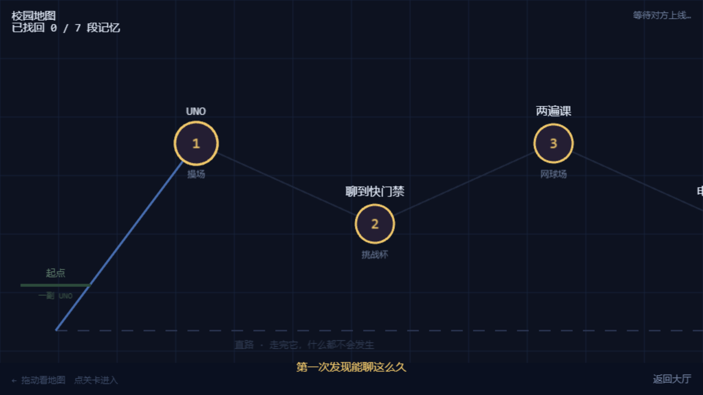
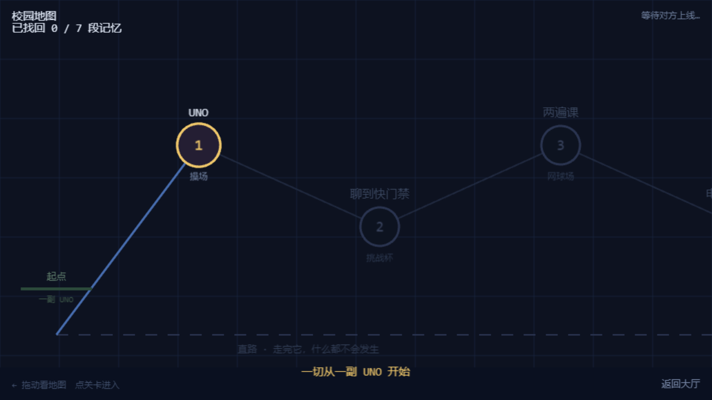

# 03 · 校园地图（Hub）

## 3.1 地图与关卡解锁

### 功能描述

大厅点「开始游戏」进入校园地图：七段记忆按时间排成一条夜路，每段是一个节点。**顺序解锁**——打完上一关才点亮下一关；左上角显示「已找回 x / 7 段记忆」。带 `?debug=1` 参数时七关全部解锁（开发/测试用）。

### 使用教程

1. 大厅点「开始游戏」（一个人时按钮文案为「一个人先进去」）；
2. 在地图上点亮着的节点，进入对应关卡；
3. 未解锁节点为暗色，点击会提示尚未找回这段记忆。

### 测试数据

| 用例 | 输入 | 期望 |
|---|---|---|
| debug 全解锁 | `?debug=1` 登录后进 Hub | 七个节点全部可点 |
| 正常进度 | 无 debug 登录后进 Hub | 仅已通关的下一关解锁 |

### 输出

- 两种情况下活动场景均为 `Hub`，地图正常渲染；
- `debug=1` 下左上角计数与节点点亮状态与全解锁一致（见截图，7 个节点全亮）。

| 用例 | 结果 | 实际输出 |
|---|---|---|
| debug=1 七关全解锁 | PASS | activeScene = Hub |
| 正常进度（未通关时） | PASS | activeScene = Hub |

### 截图

> 两图的差异在节点点亮数量：正常进度下只有第 1 关是亮的。
