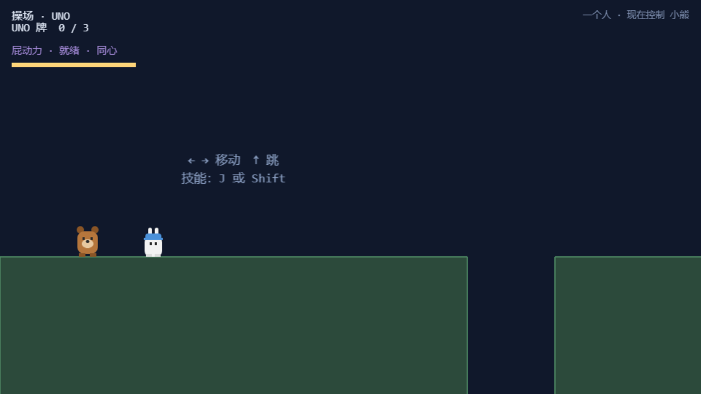
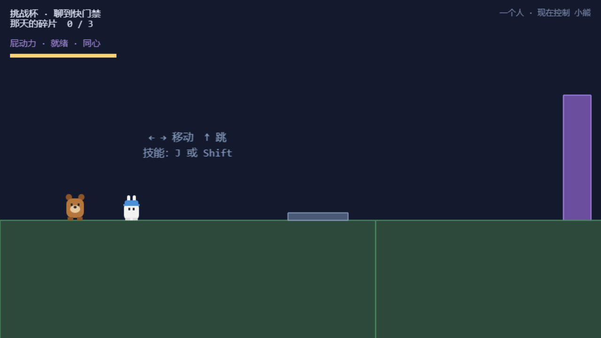
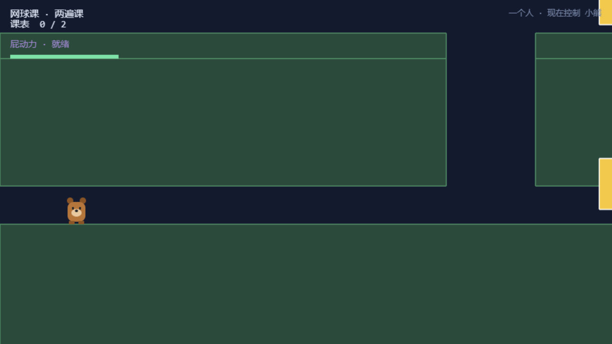
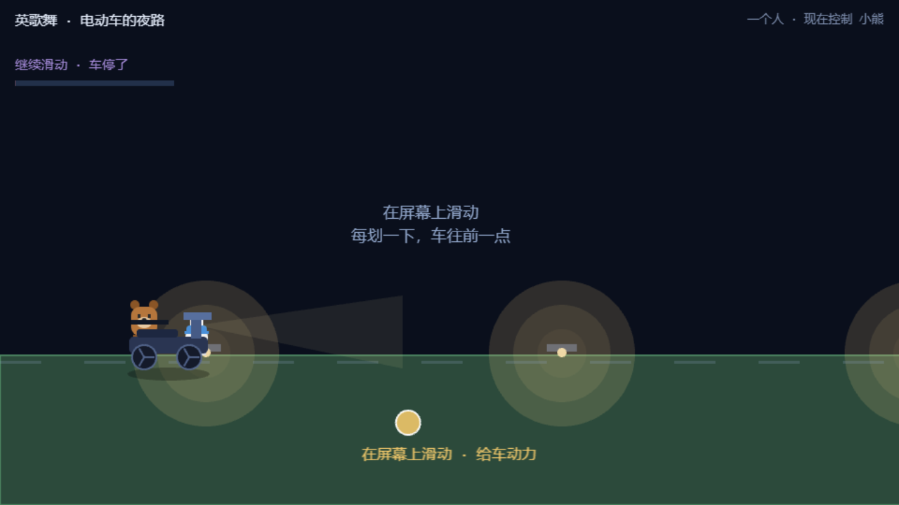
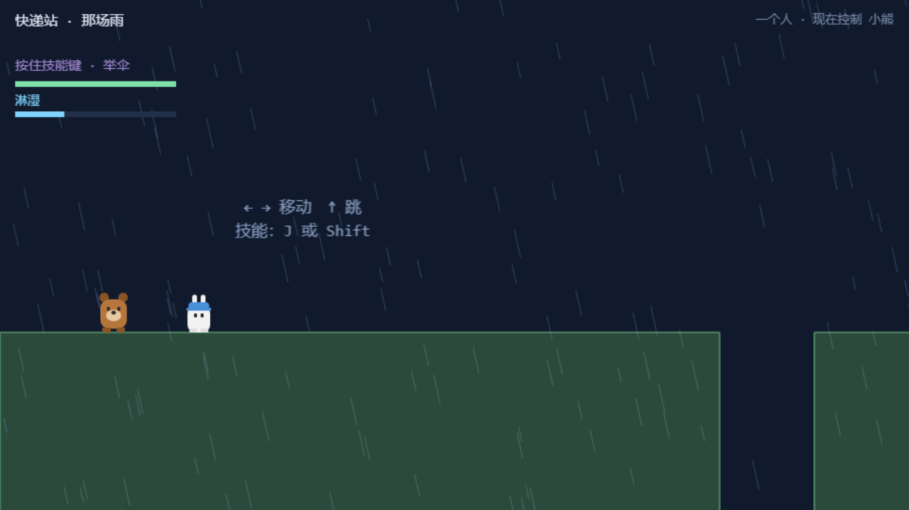
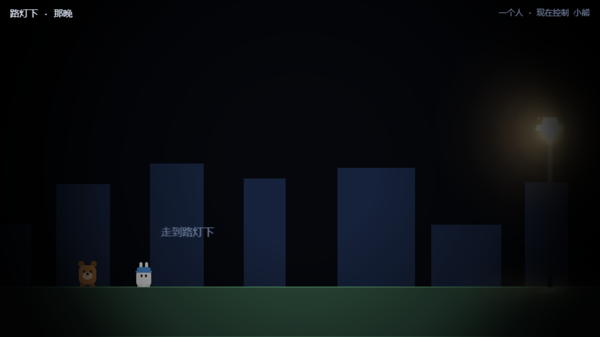
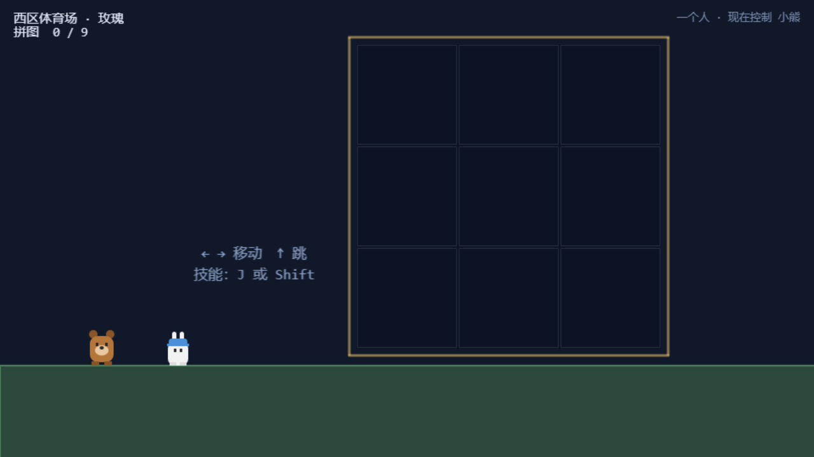

# 04 · 七关场景巡礼

七关逐关进入验证：场景加载、地形、收集物、HUD、双人初始位、背景色。每关的主题、专属机制在 [06-关卡机关.md](06-关卡机关.md) 单独展开。

### 功能描述

| 关 | 标题 | 主题机制 | 背景色 |
|---|---|---|---|
| 1 | 操场 · UNO | 收集 UNO 牌 ×3、240px 高墙（屁动力）、640px 缺口（蒲公英） | `#10182B` |
| 2 | 挑战杯 · 那通电话 | 压力板接力开门 | `#141A2E` |
| 3 | 网球课 · 第 33 遍 | 数字收集（12 → 45 翻倍演出） | `#141A2E` |
| 4 | 英歌舞 · 夜路 | 电动车骑乘 + 电量 | `#0A0F1C` |
| 5 | 快递站 · 那场雨 | 全程下雨、长按举伞、屋檐存档点、雨停演出 | `#111A2C` |
| 6 | 路灯 · 十二秒 | 留白演出（灯亮、蛾、台词），无机制 | `#05070C` |
| 7 | 西体 · 玫瑰 | 拼图 3×3 → 玫瑰出现 → 两人抬花到终点 | `#10182A` |

### 使用教程

- 从校园地图点亮节点进入；
- 操作：`←→`/`AD` 移动、`↑`/`W`/空格跳、`Q`/`Tab` 切换控制角色（独行时）、技能 `J`/`Shift`。

### 测试数据

| 关 | 小熊出生点 | 小兔出生点 | 结果 |
|---|---|---|---|
| level01 | (120, 838) | (210, 840) | PASS |
| level02 | (120, 838) | (210, 840) | PASS |
| level03 | (120, 838) | (210, 540) | PASS |
| level04 | (154, 522)* | (210, 540) | PASS |
| level05 | (120, 838) | (210, 840) | PASS |
| level06 | (140, 438) | (230, 440) | PASS |
| level07 | (120, 598) | (210, 600) | PASS |

\* level04 的小熊出生在电动车旁，读数时已被车体物理推挤，属正常。

### 输出

- 七关全部 `solo=true`（测试为独行进入）、背景色与设计值一致（如 level06 = 329484 = `0x05070C` 近全黑）、HUD 与主题文案正确（操场显示「UNO 牌 0 / 3」）。

### 截图

