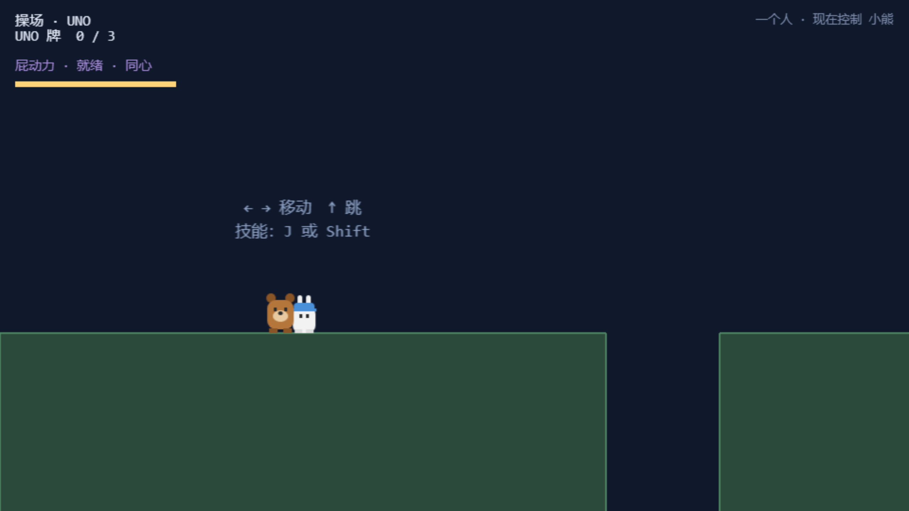
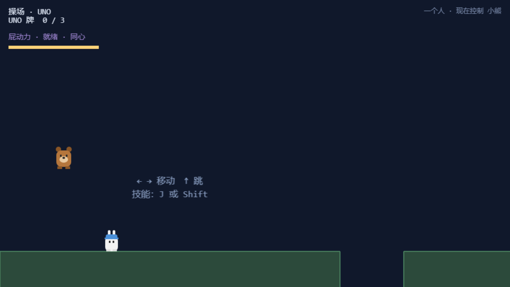
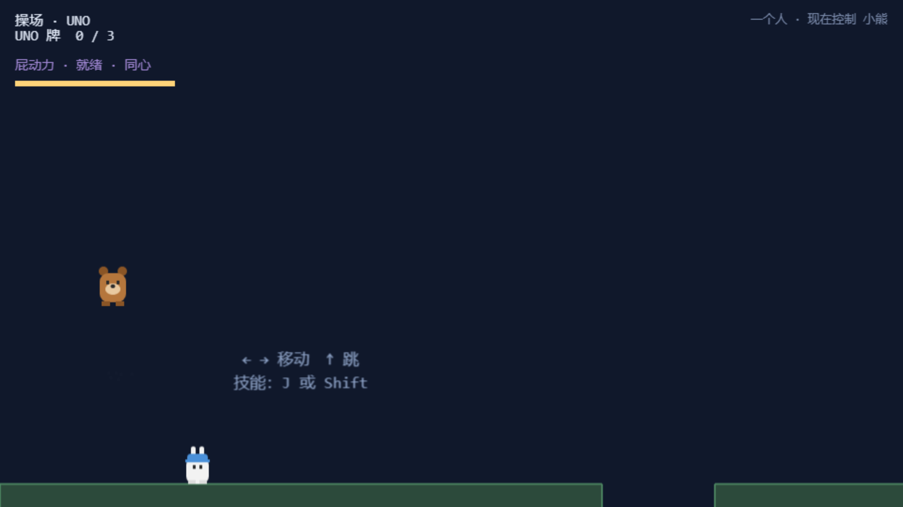
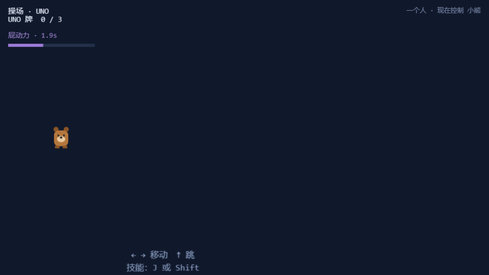
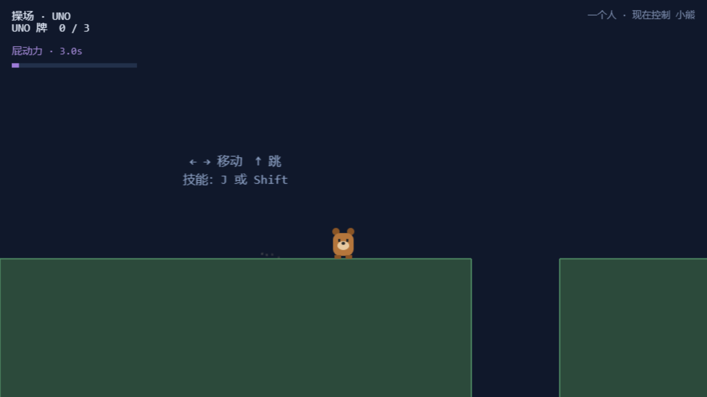
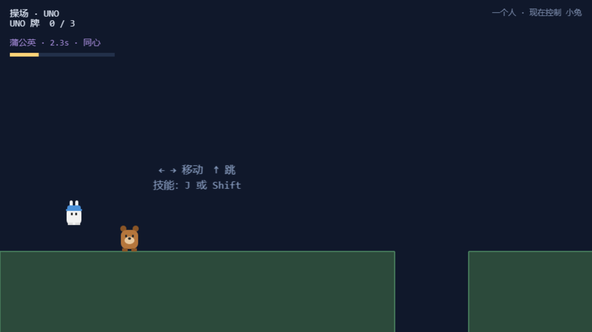
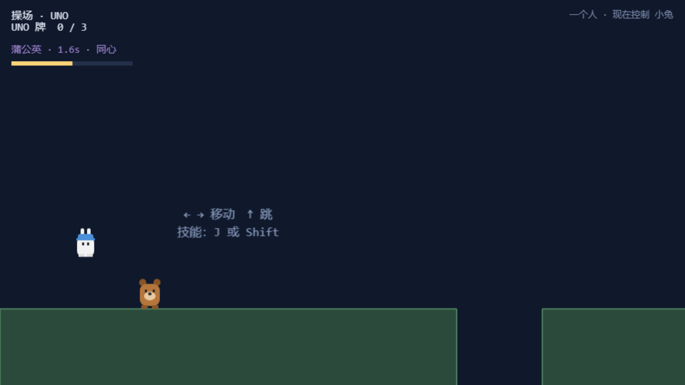
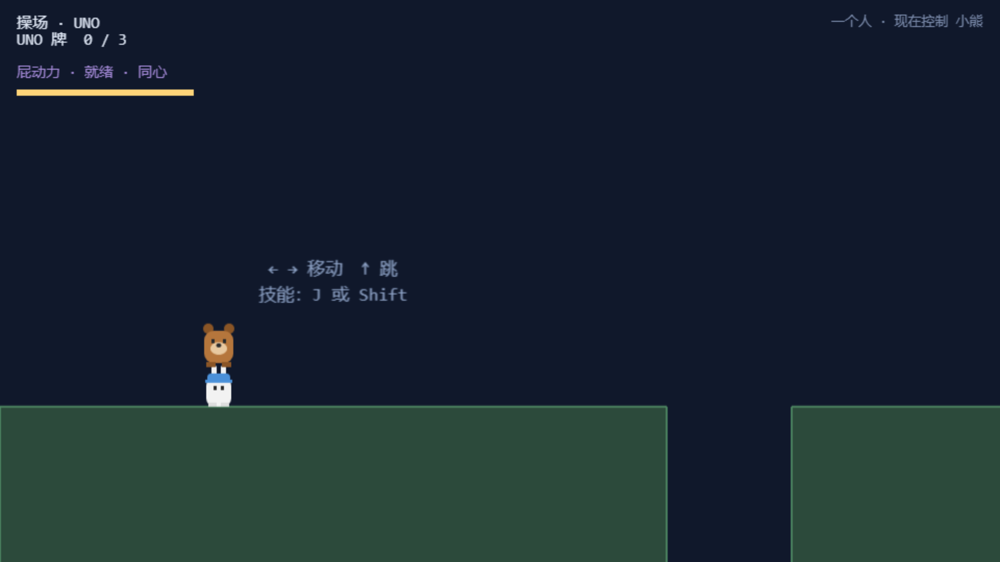
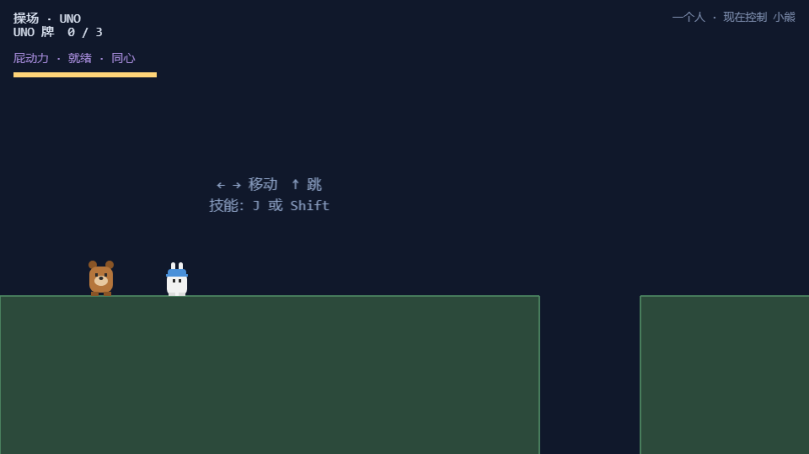

# 05 · 角色能力与技能

基础移动、跳跃、二段跳、两个角色技能（含重设计后的"一键两用"）、叠罗汉、掉坑归位、同心加成。
所有数值均来自**页面内逐帧采样**（40~50ms 一次的真实物理数据）。

> ⚠️ 位移类数据受无头低帧率影响按 ~55% 压缩（见[总览](00-总览.md)第三节），"机制是否成立"的结论不受影响。

## 5.1 移动

### 功能描述
按住方向键角色以 260px/s 匀速移动，松开即停，转向即时换向。

### 使用教程
`←→` 或 `A/D` 按住移动。

### 测试数据
按住 `D` 1.2s（页面内计时）：startX=120 → endX=292，**位移 172px**（理论 312px，无头压缩后符合预期比例）。

### 输出
持续位移，无卡顿/穿墙。**PASS**

### 截图

## 5.2 跳跃

### 功能描述
一段跳初速 700，跳跃高度 ≈163px（700²/3000）。支持土狼时间（离开平台 100ms 内仍可满力起跳）与输入缓冲（落地前 120ms 内的按键在落地帧兑现）。

### 使用教程
`↑` / `W` / 空格。

### 测试数据
站立 y=838 → 最高 y=687，**跳跃高度 151px**（理论 163，采样含帧间隔，吻合）。

### 输出
空中姿态正确（见截图：小熊离地、双腿收起）。**PASS**

### 截图

## 5.3 二段跳（空中补跳）

### 功能描述
**只在下落阶段**（vy≥0）可按出一次补跳，补跳初速 440 → 追加高度 ≈64.5px，顶点合计 ≈228px。设计上限 240px——**绝不能越过"必须屁动力"的那堵墙**，因此数值是算死的（见 `config.js` 注释）。补跳时脚下散一圈向下的尘。

### 使用教程
跳起来，感觉不够高，在**下落时**再按一次跳。

### 测试数据
下落段补跳后最高点 **232px**（理论 ≈228，误差为采样间隔）；一人可达上限 < 240px 墙，"配合仍然必要"未被破坏。

### 输出
空中出现二段跳尘粒，高度正确。**PASS**

### 截图

## 5.4 小熊技能 · 屁动力（空中：向上猛冲）

### 功能描述
空中按技能 = 垂直向上冲（初速 820 → 追加 224px）；若头顶骑着小兔，两人以相同速度一起上升（`carryImpulse`）。冷却 3.2s，同心时 2.24s。

### 使用教程
跳到空中（推荐下落段）按 `J` 或 `Shift`。

### 测试数据
跳 + 下落段触发：**总升幅 373px**（理论 ≈387 = 163+224，无头压缩下吻合）。

### 输出
角色垂直窜升，头顶伙伴（若有）同步上升。**PASS**

### 截图

## 5.5 小熊技能 · 地面冲刺（重设计新增）

### 功能描述
**站在地面**按技能 = 向前猛冲（620px/s × 320ms ≈ 198px），身后拖一串尘迹。**一离地立即失效**——否则"冲刺+跳"能飞过 640px 缺口，破坏第 1、2 关的缓降设计。一个键两种用法，不新增按键。

### 使用教程
站在平地上按 `J`/`Shift`，向前冲。

### 测试数据
冲刺位移 **118px**（无头压缩后等效于理论 198px；且测试中小兔已被挪开——她站在路径上会被物理挡住，这本身是正确行为）。

### 输出
高速位移 + 尘迹可见（截图为冲刺瞬间）。**PASS**

### 截图

## 5.6 小兔技能 · 蒲公英缓降

### 功能描述
空中按技能 = 缓降 3s：下落速度钳在 90px/s；320px 光环内的**伙伴共享缓降**。冷却 4.5s，同心时 3.15s。

### 使用教程
跳到空中下落时按 `J`/`Shift`，飘起来。

### 测试数据
触发后连续 6 个采样点 vy 全部 = **90, 90, 90, 90, 90, 90**——钳制精确。

### 输出
下落速度稳定钳制，缓降姿态（花瓣光环）可见。**PASS**

### 截图

## 5.7 小兔技能 · 上升气流（重设计新增）

### 功能描述
缓降途中按**跳** = 往上抬一小截（初速 470 → ≈74px）。每次抬升**吃掉 700ms 缓降时间**并有 500ms 自身冷却——够把"差一点点"救回来，不够当电梯用。缓降中按跳不消耗二段跳次数。

### 使用教程
缓降中再按一下跳（不是技能键）。

### 测试数据
抬升瞬间 vy = **-445**（理论 -470，采样间隔内的合理读数）。

### 输出
角色在缓降中明显上抬。**PASS**

### 截图

## 5.8 叠罗汉

### 功能描述
一个角色跳到另一个头上可以站稳（`isRiding`），上面的人随下面的人移动、一起被屁动力带上去——"两个人一起上去，而不是把人射出去"。

### 使用教程
操纵一个角色站到另一个正下方，跳到 TA 头上。

### 测试数据
将小熊置于小兔头顶正上方后：`riding=true`，小熊稳定停在 y=800（小兔 y=840，高差 = 身高），不滑落。

### 输出
承载状态成立、位置稳定。**PASS**

### 截图

## 5.9 掉坑归位

### 功能描述
掉出世界底部（voidY=1000）自动送回当前安全点，不清进度、不死机。

### 使用教程
（正常玩法）从缺口掉下去即可体验。

### 测试数据
置于缺口上空自由落体：最低点 y=**1008**（越过阈值）→ 归位后 y=**838**（= 出生点地面）。

### 输出
触底即归位，位置正确。**PASS**

### 截图

## 5.10 同心 · 合作加成

### 功能描述
两人距离 ≤320px（与缓降光环同轴）时：技能冷却恢复快 40%、缓降时长 ×1.4。HUD 三处反馈：技能条变金色、文字加「· 同心」、联机时连接线变金色。**它是奖励不是前提**——一个人玩拿不到加成也照样能通关。

### 使用教程
两个人站近一点（或独行时把两个角色凑在一起）。

### 测试数据
两角色相距 90px：`synergy=true`，技能条文字 = **「屁动力 · 就绪 · 同心」**，条为金色。

### 输出
加成状态在 HUD 明确可见。**PASS**

### 截图

