# 06 · 关卡机关（压力板 / 电动车 / 雨 / 路灯 / 拼图 / 玫瑰）

## 6.1 压力板 + 门（第 2 关 · 接力开门）

### 功能描述
踩住压力板 → 对应的门降下。板与门是 **OR** 关系（任一板被踩即开门），双人时要一人踩板、一人过门；门由"权威端"判定（同屏双人 / 房主 / 独行），避免两端各判导致门疯狂抖动。

### 使用教程
把一个角色走到板上站住，另一个从门的位置过去；独行时按 `Q` 切换角色操作。

### 测试数据
小熊走到 x=455（板面 412~508）：`onGround=true`、`localOn=["p1"]`、`platesOn=[true,false]` → **`doorOpen=[true]`**，门 rect y=1080（已降下）。

### 输出
踩板开门，判定链路完整。**PASS**（此用例曾暴露缺陷 1——独行无权威导致门锁死，已修复，见[总览](00-总览.md)）

### 截图
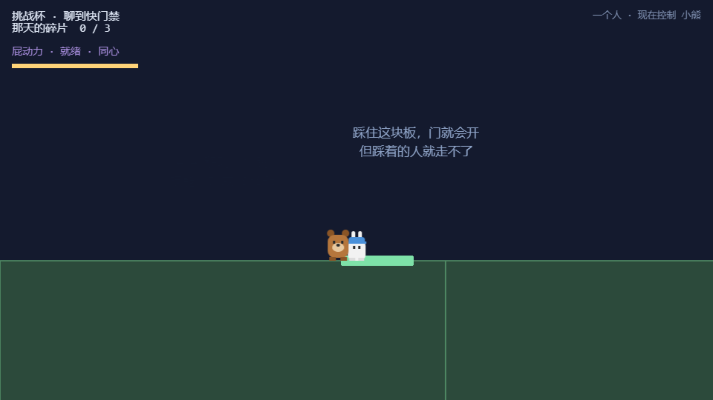

## 6.2 电动车（第 4 关 · 英歌舞夜路）

### 功能描述
夜路太长，骑上电动车赶路：**连点方向键蹬车**，速度起来后滑行；车有**电量**（蹬车积攒）与**速度**两个数值，颠簸路面会掉速。

### 使用教程
走到车旁上车 → 连按 `→`（或屏幕滑动手势）蹬车 → 电量与速度上升，一路骑向终点。

### 测试数据
蹬车 6 次：x 180 → **379**（+199px），电量 0 → **28**，速度 0 → **86**。

### 输出
蹬车 → 加速 → 前进，三个数值全部响应。**PASS**

### 截图

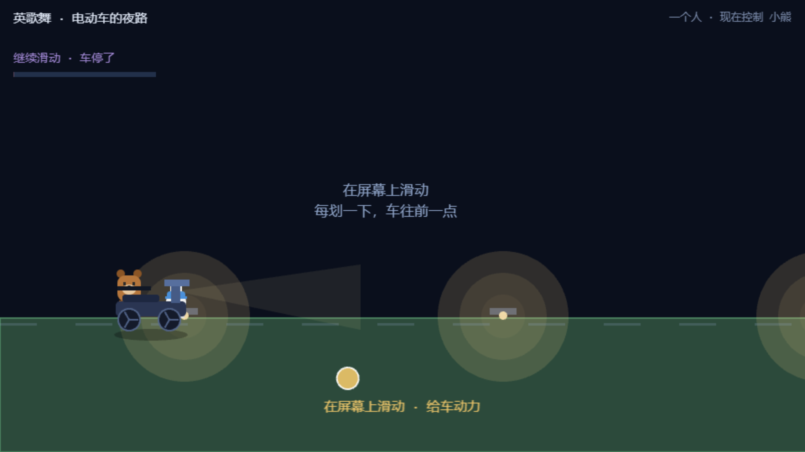

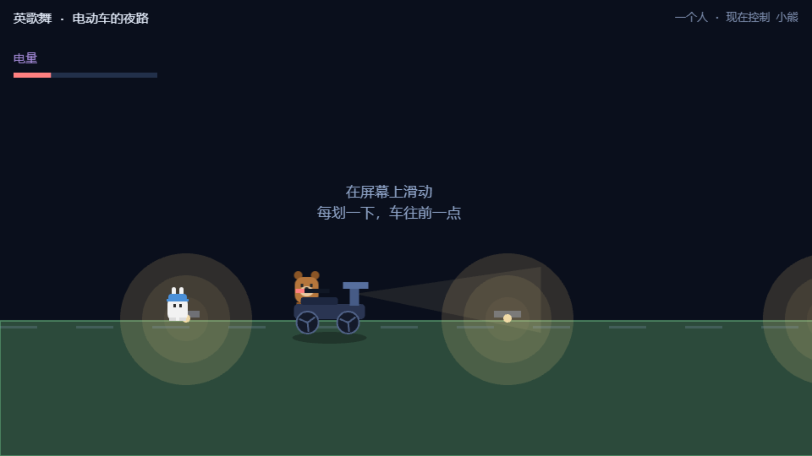

## 6.3 那场雨（第 5 关 · 核心演出关）

### 功能描述
进关即开始下雨（`intensity=1`）。雨里待着会**淋湿**（HUD 蓝条上涨）；**长按技能键举伞**可以挡雨但会消耗力气；屋檐下自动变干（并作为存档点）；走到终点触发**雨停演出**——全曲最重要的一次"音乐进来"的时刻（音频接入后生效）。

### 使用教程
按住技能键举伞前进；淋太多就去屋檐下躲一躲；冲到终点看雨停。

### 测试数据

| 用例 | 数据 | 期望 |
|---|---|---|
| 进关即下雨 | `intensity=1` | 开局氛围成立 |
| 长按举伞 | 按住 1.4s → `holdMs=1616` | 长按被持续记录 |
| 屋檐自动变干 | 置于屋檐(1820~2120)下 → `inShelter=true` | 存档点生效 |
| 雨停演出 | 调用雨停 → 3s 后 `intensity=0` | 雨退场，进入结算 |

### 输出
四项全部 **PASS**；淋湿条在截图中可见（约 30%）。

### 截图

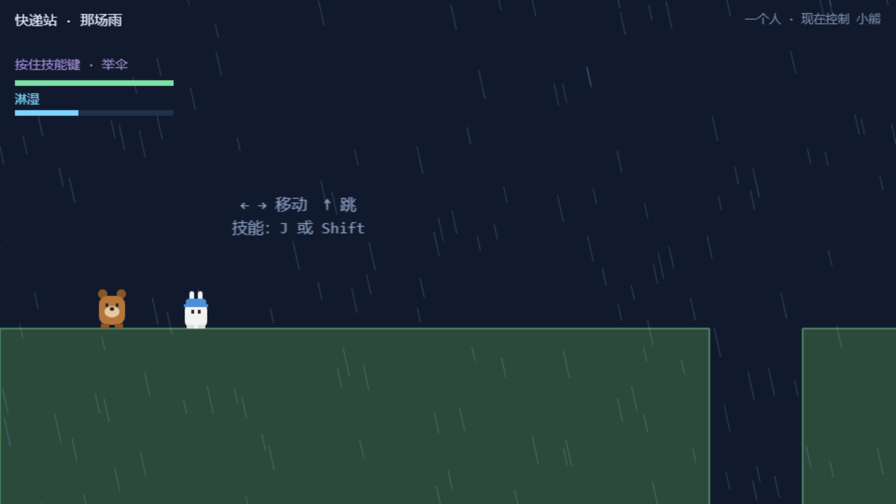

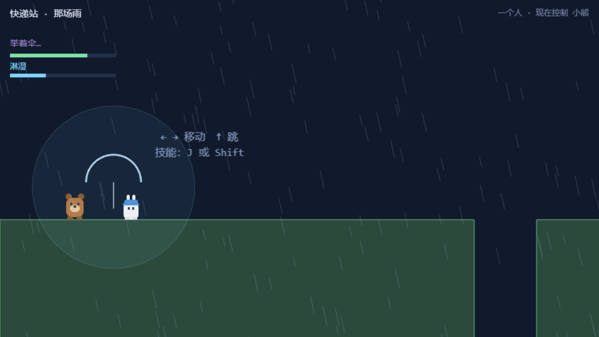

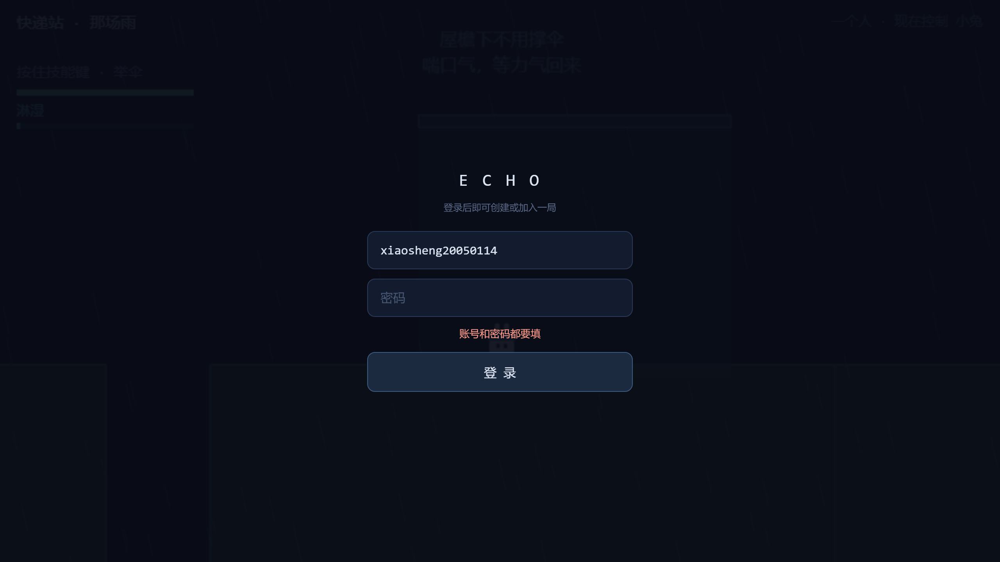

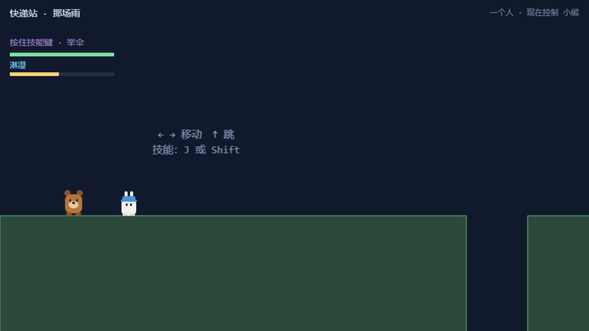

## 6.4 路灯留白（第 6 关）

### 功能描述
全作最暗的一关（背景 `#05070C` 近全黑）：走进路灯的光圈，灯亮、蛾子聚拢、台词逐字浮现——**没有机制、没有 BGM**，这段留白本身就是内容。

### 使用教程
一直往右走，站在灯下，看完那段安静。

### 测试数据
进入后等待 3.6s 截图：灯亮 + 光晕 + 双人剪影正常渲染，场景无异常报错。

### 输出
留白演出完整呈现。**PASS**

### 截图
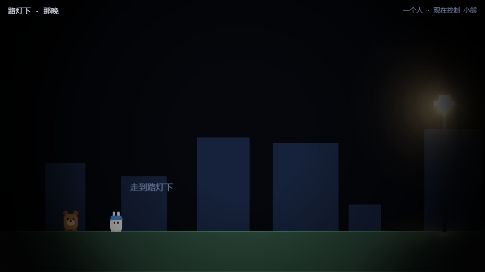

## 6.5 拼图 3×3（第 7 关 · 那张照片）

### 功能描述
第 7 关把一张**真实的照片**切成 9 块散落在场景里，两人把碎片拖回画框、逐块吸附（「咔」），9 块集齐触发闪光演出 → **玫瑰出现**。这块画框 360×360，是全场唯一"真实的脸"出现的地方。

### 使用教程
靠近碎片拖拽（触屏拖动 / 鼠标拖动）→ 吸附进画框 → 集齐 9 块。

### 测试数据
9 块全部吸附：`placed=9` → `roseUnlocked=true` → `roseState="carried"`（玫瑰出现并进入可抬状态）。

### 输出
吸附、闪光、玫瑰出现，链路完整。**PASS**

### 截图

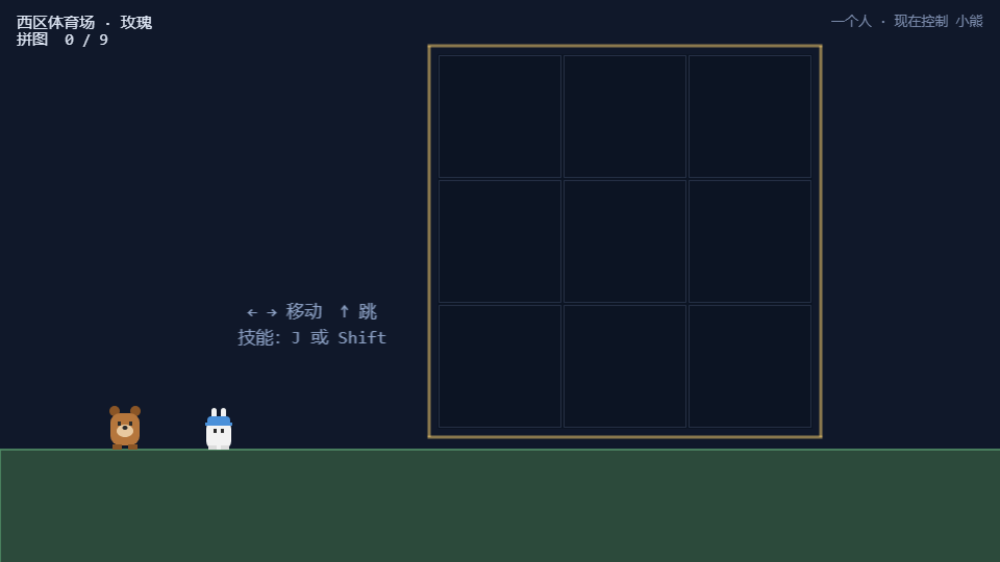

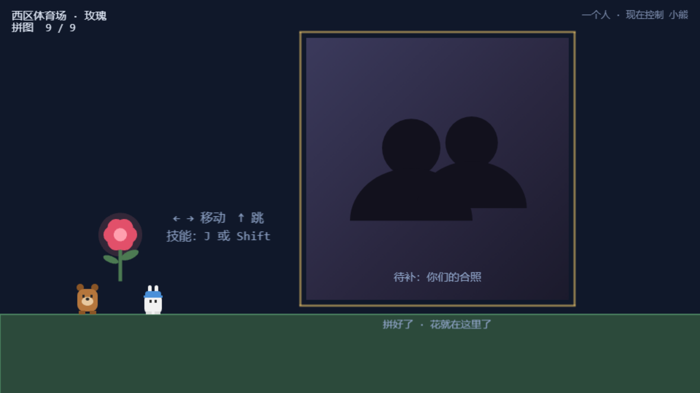

## 6.6 抬花（第 7 关 · 终点演出）

### 功能描述
玫瑰出现后，**两人必须靠近（<150px）**才能把它抬起来，然后一路抬到终点——最后一段路必须是两个人一起走完的。

### 使用教程
两人走到玫瑰旁 → 花自动浮起（被抬起）→ 保持靠近走到终点。

### 测试数据
两角色相距 100px 放置：1.4s 后 `roseState="carried"`，`carryMs=3578`（累计抬持时长在增长）。

### 输出
靠近即抬起，共同抬持成立。**PASS**

### 截图
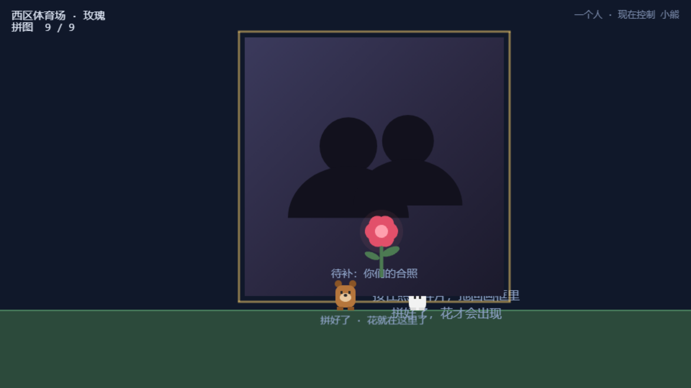
