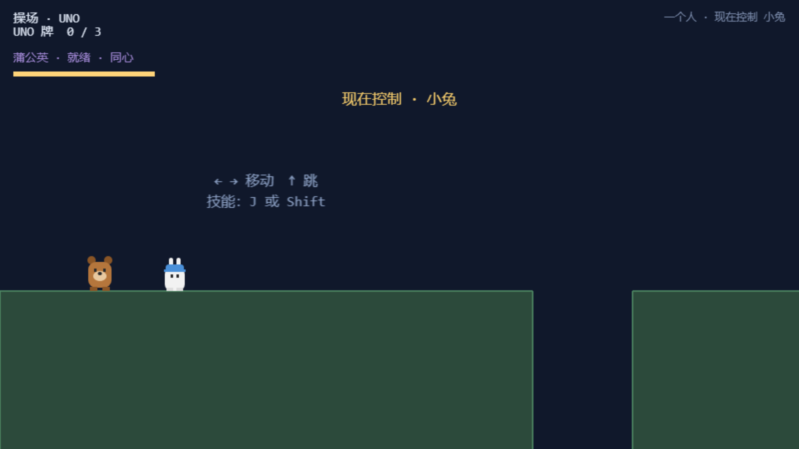

# 07 · 移动端与独行模式

## 7.1 独行模式 · 切换控制角色

### 功能描述
一个人也能玩完整个游戏：进关时若没有队友（未联机或对方不在线），自动进入**独行模式**，右上角显示「一个人 · 现在控制 小熊」；按 `Q` 或 `Tab` 在两个角色间切换，待机的角色由跟随逻辑托管。技能、机关判定在独行下全部自洽（压力板用例即证明）。

### 使用教程
- 一个人进入关卡 → 自动独行；
- `Q` / `Tab` 切换操控的角色；触屏点「换」。

### 测试数据

| 状态 | solo | 当前角色 | HUD 文案 |
|---|---|---|---|
| 切换前 | true | bear | 一个人 · 现在控制 小熊 |
| 按 Q 后 | true | **rabbit** | **一个人 · 现在控制 小兔** |

### 输出
切换即时生效，HUD 同步更新。**PASS**

### 截图

## 7.2 移动端虚拟按键

### 功能描述
触屏设备（`hasTouch`）自动出现虚拟按键：左右移动、跳、换、技能——布局避开游戏区域，配合 FIT 缩放在竖屏手机上完整可见。

### 使用教程
手机/平板打开即出现，无需设置；虚拟按键与键盘输入走同一套输入层（`setJump/setSkill` 公开接口）。

### 测试数据
390×844 触屏视口进入第 1 关：`hasTouch=true`，虚拟按键渲染于画面底部，游戏区域无遮挡。

### 输出
触屏输入层激活，按键可见。**PASS**

### 截图

> 注：截图为无头触屏仿真的 390×844 视口，与真机浏览器渲染一致；真机上的多点触控手感建议上架前用真手机再过一遍。
