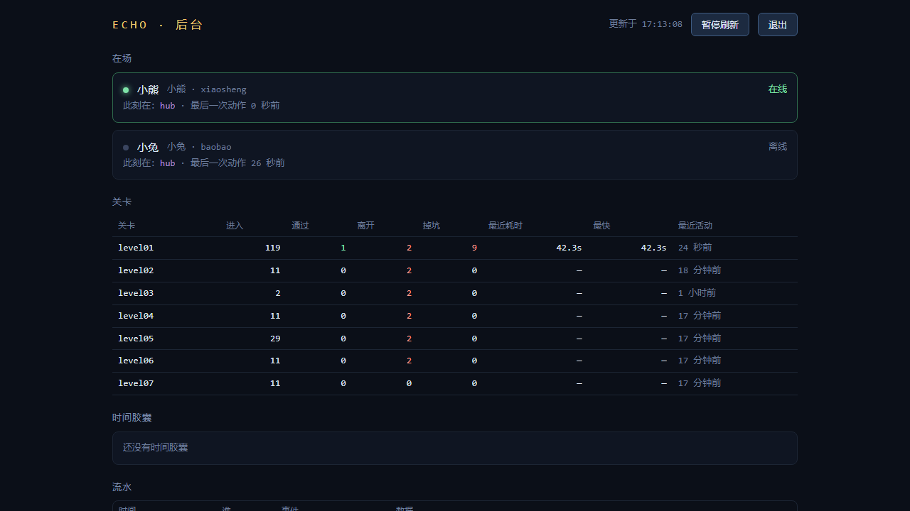

# 08 · 结尾、后台与系统

## 8.1 结尾 · 那封信（Ending）

### 功能描述
第 7 关抬花到终点后进入结尾演出：那封信逐行浮现，最后揭晓"存档损坏"反转的真正含义。空格/点击推进节奏。

### 使用教程
打完第 7 关自动进入；或（测试）直接 `scene.start('Ending')`。按空格推进。

### 测试数据
进入后等待 4.5s 截图第一幕；连按 3 次空格推进后截第二幕。场景始终为 `Ending`，演出正常推进、无异常。

### 输出
信件演出渲染完整。**PASS**

### 截图

## 8.2 后台看板（/admin）

### 功能描述
给运营（你）看的数据面板：登录后展示**在场玩家、各关卡通关统计、时间胶囊、事件流水**四个区块，数据来自服务端 SQLite 与实时遥测。

### 使用教程
浏览器打开 `http://<服务器>/admin` → 输入管理员账号密码 → 进入看板。

### 测试数据
`xiaosheng` 登录：关卡统计表渲染 **8 行**（表头 + 七关），页面文本量 6201 字符，四个区块齐全。

### 输出
看板正常渲染，统计表有数据。**PASS**

### 截图

## 8.3 健康检查（/api/health）

### 功能描述
运维探针：返回服务存活、活跃房间数、在线连接数、运行时长。

### 测试数据
`GET /api/health` → `{"ok":true,"liveRooms":0,"clients":1,"uptime":6182}`

### 输出
`ok:true`，字段齐全。**PASS**（无截图，纯接口）

## 8.4 行为遥测（/api/track）

### 功能描述
游戏内关键行为（关卡开始/通关/失败等）匿名上报到服务端，落 SQLite，供后台看板统计——你能看到她玩到了哪一关、卡在哪里。

### 测试数据
登录 + 进入第 1 关的过程中监听 `/api/track` 响应：收到 **2 次上报，均为 200**。

### 输出
遥测链路（游戏 → 服务端 → 确认）工作正常。**PASS**（无截图，响应码为准）

## 8.5 静态资源 gzip 压缩

### 功能描述
服务器自实现的零依赖压缩中间件：启动时对 `dist` 里的 js/css/html 等生成预压缩 `.gz` 副本，请求时按 `Accept-Encoding` 回复压缩体——首屏体积对手机流量与弱网加载至关重要。

### 测试数据（Resource Timing 实测）

| 文件 | 传输字节 | 解压后 | 压缩率 |
|---|---|---|---|
| index-*.js（游戏代码） | 34,930 | 103,701 | **66% ↓** |
| phaser-*.js（引擎） | 337,564 | 1,478,994 | **77% ↓** |
| rabbit.png（图片本身已压缩） | 8,908 | 8,608 | 不重复压缩 ✓ |

### 输出
js 类资源 gzip 生效且比例显著；图片正确地**未**二次压缩。**PASS**

> ⚠️ **运维注意**：`.gz` 副本在**服务器启动时**生成。每次 `npm run build` 之后必须**重启服务器**，否则新产物没有 `.gz`，gzip 会静默失效（本次测试真实复现过一次：build 后未重启 → 传输字节≈解压字节）。此条已写入 [00-总览](00-总览.md) 的复现步骤。
