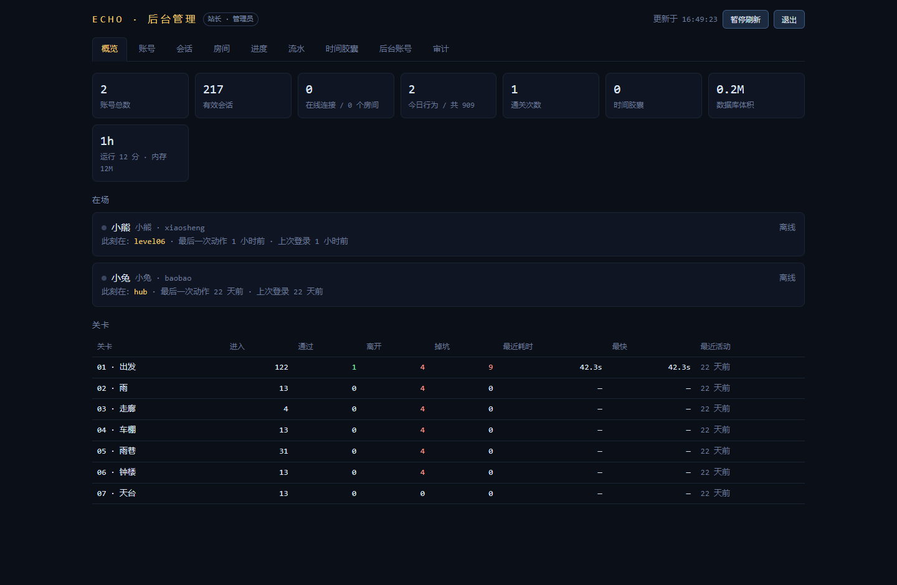
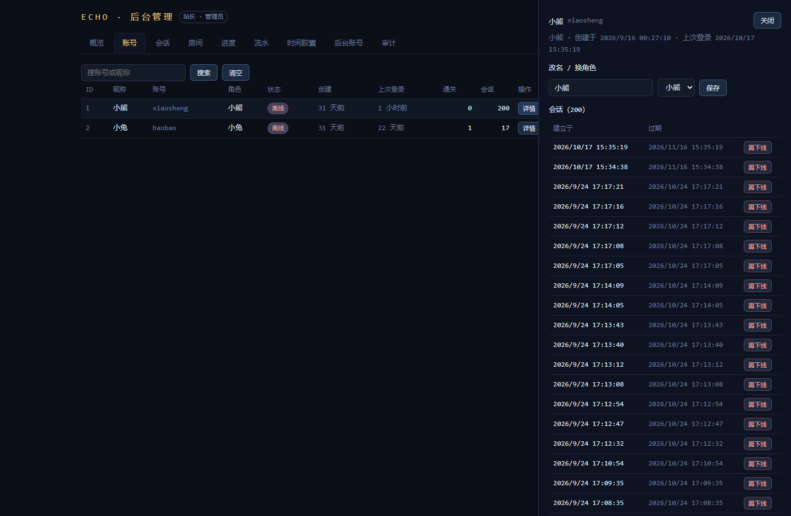
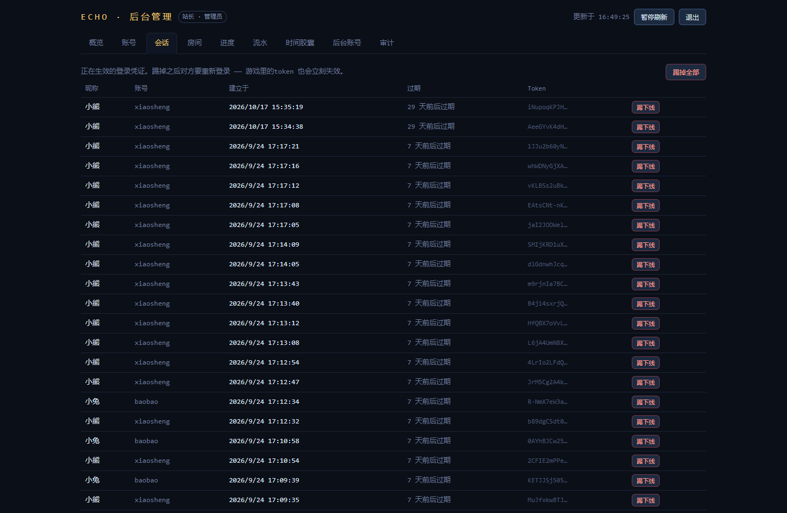
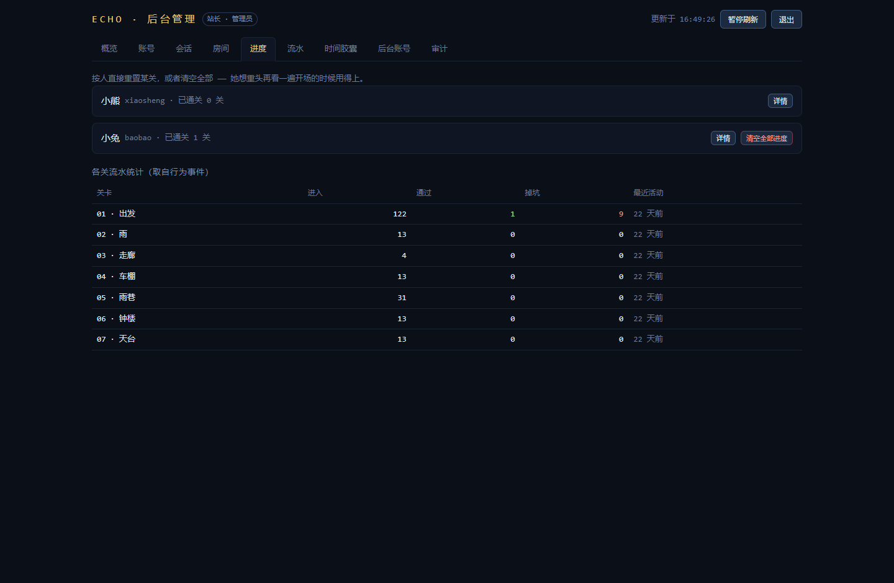
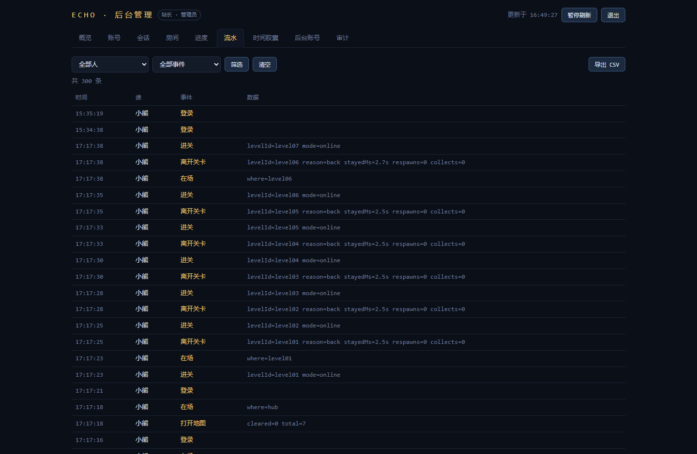
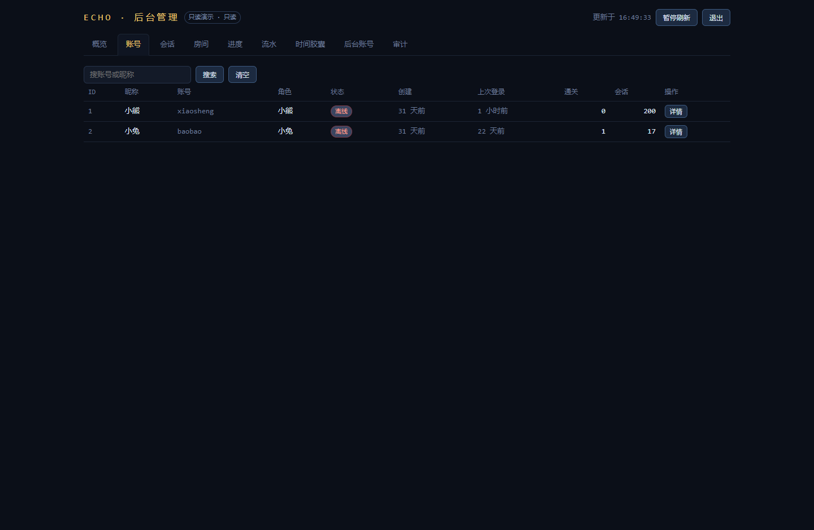
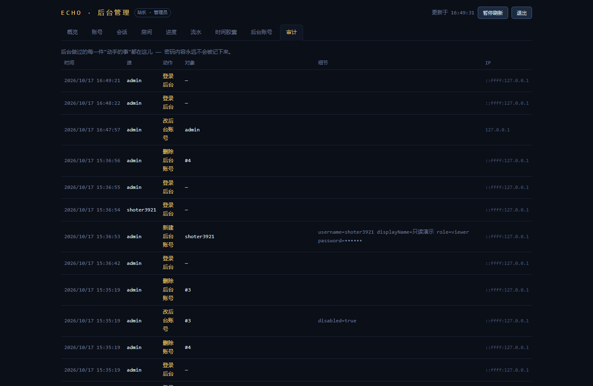

# 09 · 后台管理系统（管理员系统）

- **测试日期**：2026-10-17
- **测试方式**：Node 脚本直连管理 API 做权限边界与数据验证（56 条断言）＋ Playwright 截图验证页面
- **结果**：**56 / 56 全部通过**
- **改动文件**：`server/db.js`（＋3 张表、管理查询函数）、`server/index.js`（独立管理员鉴权＋20 个管理 API）、`server/views/admin.html`（整体重写为多标签管理台）

## 〇、这套系统解决什么问题

原来的「后台」只是一个**只读看板**（在场状态＋关卡统计＋流水），而且鉴权方式是：

> 用**游戏账号**登录 ＋ 一份用户名白名单（`ECHO_ADMIN_USERS=xiaosheng`）

这个做法有个绕不开的隐患：**她的账号和你的账号在同一张表里，权柄只靠一份名单隔开**。现在改为：

| | 旧 | 新 |
|---|---|---|
| 管理员身份 | 游戏账号 + 白名单 | **独立的 `admins` 表**，她的记录根本不在这张表里 —— 结构上不可能成为管理员 |
| 凭证存放 | localStorage（JS 可读） | **HttpOnly Cookie**（页面 JS 读不到），SameSite=Strict |
| 会话有效期 | 30 天 | **8 小时** |
| 能力 | 只读 | **完整管理**：账号增删改、停用、重置密码、踢下线、关房间、重置进度、审计 |
| 操作留痕 | 无 | 每个写操作自动进 `admin_audit` 表（含 IP，密码不明文落库） |

**初始账号**：首次启动自动生成（随机 16 位密码），打印在启动日志里，同时写入 `server/data/后台初始密码.txt` —— 登录后请改密码并删掉这个文件。

## 一、登录与鉴权

### 功能描述
独立于游戏账号的登录。凭证是 HttpOnly Cookie，连续输错 6 次锁定该 IP 10 分钟。

### 使用教程
浏览器打开 `http://localhost:8787/admin`（可用环境变量 `ECHO_ADMIN_PATH` 改成别的路径），输入后台账号密码。

### 测试数据

| 用例 | 输入 | 期望 |
|---|---|---|
| 未登录访问管理 API | `GET /api/admin/stats`（无 Cookie） | 401 |
| 密码错误 | `admin` + `wrong-password` | 401 |
| 正确登录 | 初始账号 + 随机密码 | 200，`Set-Cookie: echo.admin=…; HttpOnly; SameSite=Strict` |
| 读取身份 | `GET /api/admin/me` | 返回 `{role:'owner'}` |
| 连续输错 | 同一 IP 错 6 次 | 第 7 次起 429 |

### 输出
56 项断言中鉴权相关 6 项全部通过；Cookie 实测带 `HttpOnly` 和 `SameSite=Strict` 标记。

### 截图

## 二、概览

### 功能描述
一屏看清：账号总数、有效会话、在线连接/房间、今日行为、通关次数、胶囊数、数据库体积、运行时长与内存；下方保留原看板的「在场」「关卡统计」两块。

### 使用教程
登录后默认落在「概览」标签，每 5 秒自动刷新（右上角可暂停）。

### 测试数据
实测返回：账号 2 · 有效会话 217（历史累计）· 今日行为 2/共 909 · 通关 1 次 · 数据库 0.2M。

### 输出
`GET /api/admin/stats` 返回 `counts`（9 项业务统计）+ `runtime`（uptime/liveRooms/clients/heap/node 版本）。

### 截图

## 三、账号管理（核心）

### 功能描述
游戏账号的增删改查：搜索、新建、改昵称/角色、**停用/启用**、**重置密码**、**删除**（连带清进度/流水/胶囊）、查看单人详情（会话、每关进度、最近 60 条行为）。

### 使用教程
「账号」标签 → 搜索或直接看列表 → 行内按钮操作。「详情」打开右侧抽屉，抽屉里可改名/换角色/踢会话/重置单关或全部进度。

### 测试数据

| 用例 | 输入 | 期望 | 实测 |
|---|---|---|---|
| 新建账号 | `tmptest**** / 临时测试 / bear / test123456` | 200 | ✓ |
| 重名 | 同名再建一次 | 409 | ✓ |
| 账号名非法 | `x`（1 位） | 400 | ✓ |
| 弱密码 | `123` | 400 | ✓ |
| 改资料 | 昵称→改过名字，角色→rabbit | 200 且落库 | ✓ |
| **停用联动** | `PATCH disabled:true` 后用该账号登录游戏 | **403 拒绝** | ✓ |
| 重新启用 | `disabled:false` 后再登录 | 200 恢复 | ✓ |
| 重置密码 | 新密码 `newpass888` | 旧密码 401 / 新密码 200 | ✓ |
| 删除 | `DELETE /api/admin/users/:id` | 200，再删 404 | ✓ |

> 停用联动是重点验证项：「停用」如果只改一个字段而不拦截登录，就是装饰品。实测停用后游戏登录立即 403，WebSocket 建连也会被拒（`4003`）。

### 输出
`admin_audit` 表新增 `user.create / user.update / user.reset_password / user.delete` 记录，操作者、IP、脱敏参数齐全。

### 截图

## 四、会话管理

### 功能描述
查看所有生效中的登录凭证；踢下线（单个/按人/全部）。踢下线 = 删会话记录 **＋ 断开 WebSocket 连接**，双管齐下才算真的掉。

### 使用教程
「会话」标签看列表；行内「踢下线」；右上「踢掉全部」用于紧急情况。

### 测试数据
给测试账号登录拿 token → 会话列表可见 → 按 token 踢 → 用该 token 调 `/api/me` → **401**；会话数 −1。

### 输出
`session.revoke` 审计记录。

### 截图

## 五、房间管理

### 功能描述
房间有两份状态：**内存里的实时连接**（谁此刻在房间里）和**数据库记录**（未关闭的房间）。两边都展示；支持一键「关闭并踢出」—— 两个人卡住时最快的解围方式。

### 使用教程
「房间」标签 → 在线房间行内「关闭并踢出」（有二次确认）。

### 测试数据
空房间时两份列表均为空；关闭不存在的房间号 `ZZZZ` → 200（幂等，不报错）。

### 输出
`room.close` 审计记录。

### 截图

## 六、进度管理

### 功能描述
按人查看已通关数、重置单关或清空全部进度 —— 「她想重头再看一遍开场」的时候用得上。

### 使用教程
「进度」标签 → 选人 → 「详情」进抽屉逐关重置，或「清空全部进度」。

### 测试数据
重置测试账号全部进度 → 200；重置不存在的用户 `999999` → 404。

### 输出
`progress.reset` 审计记录（含 levelId 或「全部」）。

### 截图

## 七、行为流水

### 功能描述
原看板流水的增强版：可按**人**、按**事件名**筛选（事件名下拉从数据自动生成，不会过期），一键导出 CSV（带 BOM，Excel 打开不乱码）。

### 使用教程
「流水」标签 → 两个下拉选择筛选 → 「筛选」；「导出 CSV」下载当前筛选结果。

### 测试数据
按 `userId` 筛选后断言返回的每条 `user_id` 都等于该用户 → 通过。

### 输出
`GET /api/admin/events` 返回 `{events, names}`。

### 截图

## 八、时间胶囊

### 功能描述
与原看板一致：列出胶囊与封存倒计时，**正文默认折叠** —— 知道她写了就够了，写了什么留到一年后。这是这个项目刻意保留的克制，管理权限再大也不该默认撬开。

### 使用教程
「时间胶囊」标签直接看。

### 输出
倒计时天数（「封存中 · 还有 N 天」/「已到期」）。

### 截图

## 九、后台账号管理

### 功能描述
管理员自己的账号体系：新建（**管理员 owner / 只读 viewer** 两级）、改密码、停用、删除。内置三道自我防护：不能停用自己、只剩一个 owner 时不能把自己降级/删除、不能删正在使用的自己。

### 使用教程
「后台账号」标签 → 「+ 新建后台账号」；给帮你看数据的人建 **viewer** —— 只读，没有删号的权力。

### 测试数据

| 用例 | 期望 | 实测 |
|---|---|---|
| 新建 viewer → 登录 → 读数据 | 200 可读 | ✓ |
| viewer 建游戏账号 | **403** | ✓ |
| viewer 删她的账号 | **403**（她的账号安全了） | ✓ |
| owner 停用自己 | 400 | ✓ |
| 只剩一个 owner 时降级自己 | 400 | ✓ |
| 删除正在使用的自己 | 400 | ✓ |

### 输出
viewer 视角下，所有写操作按钮在页面上直接不渲染（前端拦截只是体验，真正的拦截在服务端 403）。

### 截图

## 十、审计日志

### 功能描述
后台做过的每一件「动手的事」都留痕：时间、操作者、动作、对象、脱敏参数、IP。**密码字段在写入前就被替换成 `••••••`** —— 审计表里永远翻不到明文。

### 使用教程
「审计」标签直接看，最新的在最上面。

### 测试数据
本轮自测产生的写操作共 9 类（建号/改资料/重置密码/删号/踢下线/关房间/重置进度/建后台账号/登录），断言全部出现在审计表 → 通过；并断言审计内容不含 `newpass888` 明文 → 通过。

### 输出

## 十一、回归：游戏本身没被改坏

| 用例 | 期望 | 实测 |
|---|---|---|
| 原有账号登录 | 200 | ✓ |
| 查房间号接口 | 正常返回 `exists:false` | ✓ |
| 不存在的账号登录 | 401 且文案统一（无账号枚举） | ✓ |
| 健康检查 | ok | ✓ |

## 十二、运维须知（重要）

1. **改掉初始密码后，删掉 `server/data/后台初始密码.txt`**。
2. **输错 6 次被锁 10 分钟怎么办**：锁定计数在内存里，`重启服务` 即解锁；或者等 10 分钟。
3. **忘记后台密码**：`node .testtools/reset-admin-password.mjs 新密码 admin` —— 不必删库重启（密码是 scrypt 哈希，改不了库就只能走脚本），改完会同时清掉该账号的旧会话并在审计表补一条记录。注意脚本**不受**「至少 8 位」限制，是给紧急恢复留的口子。
4. 想把后台藏在别的路径：启动时设 `ECHO_ADMIN_PATH=/你的秘密路径`。
5. 管理会话 8 小时过期是刻意的 —— 忘了关也不会一直开着。
